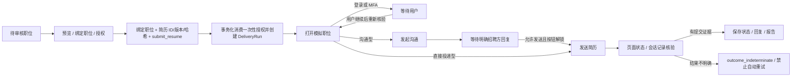

# AutoHunt：当前架构与能力清单

> 当前完整说明见 [详细技术文档（2026-10-15）](technical-documentation.md)，对应 `ef419a5`。下文保留历次说明，部分内容已过时：例如当前计划上限为32步、每批执行8步，已存在多职位快速沟通/轮流监测及持久评估。请勿将旧表中的限制或未实现项直接视为当前版本结论。

2026-10-11 更新：删除通用工具授权核对，普通工具走 schema/依赖校验与持久执行；投递保护仅在投递模块。计划启用原子更新会话记录与执行指针。当前分工及验证见 [工具执行简化](tool-dispatch-simplification.md)；旧 Review 文档保留历史背景，运行层见 [会话与统一运行层](agent-runtime.md)。

更新于 2026-09-18。本文描述当前代码，不把设计中的模块视为已经实现。定位为**本地、单用户、有人类接管的求职 Agent MVP**；不是无人值守的多租户招聘机器人。

## 1. 实际调用链

```mermaid
flowchart TB
  UI[Next.js 工作台] --> Proxy[同源 API 代理 / 服务端 Token]
  Proxy --> HTTP[FastAPI / HTTP Middleware]
  HTTP --> Runtime[AgentRuntime / 会话隔离 / 运行与事件持久化]
  Runtime --> Main[AutoHuntAgent]
  Main --> Router[规则路由 → 可选小模型 → 主模型回退]
  Router --> Fast[完整单目标规则处理]
  Router --> Planner[主模型无工具完整目标规划]
  Planner <--> LLM[LLMManager / DeepSeek / 出口脱敏]
  Planner --> Runner[参数与依赖校验 / 最多8步依赖图 / claim检查点]
  Fast --> Registry[内部 AgentToolRegistry]
  Runner --> Registry
  Runner --> Runtime
  Registry --> State[候选人档案 / 偏好 / 简历提案]
  Registry --> Jobs[职位库 / 匹配 / 统计]
  Registry --> Search[BrowserAutomationService]
  HTTP --> Delivery[DeliveryAutomationService]
  Search --> Lock[同一数据根目录的 OS 浏览器串行锁]
  Delivery --> Lock
  Lock --> Session[BrowserSession / CDP 接入或托管 Chromium]
  Session --> Adapters[BOSS 搜索 Adapter / 模拟站搜索与投递 Adapter]
  Adapters --> Human[登录 / CAPTCHA / MFA 人工接管]
  State --> Files[加密文件 + memory.md + skills]
  Jobs --> SQLite[SQLite / SearchRun / DeliveryRun / Conversation / 职位 / 授权 / 回复]
  Client[外部本地 MCP Client] --> MCP[stdio MCP Server / 18 个白名单工具]
  MCP --> State
  MCP --> Jobs
  MCP --> Files
  HTTP --> Broker[AgentRuntime / 2 个执行槽 / 持久化 JD 分析任务]
```

重要区别：主 Agent **直接调用 Python 工具注册表**，不是经 MCP 传输调用自身。MCP Server 是面向其他本地客户端的独立入口，工具集更窄。不要把两条入口合称为“所有操作都通过 MCP”。

## 2. 功能清单

| 模块 | 当前实现 | 限制 / 尚未实现 |
|---|---|---|
| 对话与意图 | 完整单目标规则快路径、可选小模型分类提示、主模型完整目标规划、持久化依赖执行；会话 DST、缺槽补充、稳定对象引用、SSE 与取消 | 本地单用户；没有持久自动化回归覆盖，未证明所有自然语言准确率；旧原生循环仅兼容恢复 |
| 模型配置 | Mock、DeepSeek Provider、前端 BYOK、凭据加密保存、连接测试 | 本次未验证真实模型质量、价格或供应商可用性；不等于支持任意模型 |
| 简历上传 | PDF/DOCX/TXT 解析、原文件加密、完整简历按提取原文导入；画像分析旁路运行 | 没有扫描件 OCR；文本抽取不等于复刻 PDF 原版式 |
| 项目材料 | 课程/报告/代码/安全 ZIP 解析，文档分类，中文项目证据生成 | LLM 事实质量需要人工复核；不运行上传代码 |
| 简历编辑 | 结构化主简历、版本历史、修改提案、逐项接受/拒绝、手工编辑、浏览器打印 PDF | 职位定制版尚无完整创建/选择/投递闭环；历史版本存在不等于已有恢复 UI |
| 原文 + 新项目 | 原文保留，新确认项目作为补充经历保存、展示和编辑 | 补充经历目前仍使用 Markdown 编辑；保留分隔标题 |
| 偏好 | 主简历派生方向、显式长期偏好、持久化会话搜索条件分离；字段来源/版本、编译 prompt_context | 模型不能把临时搜索条件隐式写为长期偏好；简历识别质量仍需核对 |
| 搜索 | 模拟站、BOSS DOM 适配；搜索/城市筛选/抽取、暂停/继续/中断、任务证据；SearchRun 和逐阶段漏斗持久化 | 真实 BOSS 当前版本未实站验收；验证码不自动解决；进程重启后搜索安全停止而非自动续跑；不是任意网址通用 Agent |
| 匹配 | 批量卡片初筛、JD 规则兜底/LLM 匹配、有限并发分析 | 不是校准后的录用概率；未知技能/卡片抽取漏召回仍需评估 |
| 职位与看板 | 标准化、去重、SQLite 保存、分阶段看板、检索结果和回复 | 不是生产级多租户数据库；统计不同页面使用不同时间范围 |
| 投递 | 模拟站直接申请和“先沟通→明确回复→发送简历”；预览绑定简历 ID/版本/哈希、职位/目标 URL 和动作；授权消费与 DeliveryRun 创建事务化；执行使用 run 固化的目标 URL；结果核验 | **真实 BOSS 投递未开放**；模拟文件消息不代表真实 PDF 附件上传成功 |
| 回复监测 | 当前投递 Worker 定时检查回复并保存到看板；等待状态和 checkpoint 持久化，重启后按 run_id 可显式恢复 | 多职位公平轮询队列尚未实现；重启后不会无人值守自动接管浏览器 |
| 安全 | Token、限流、审计、加密、工具策略、OS 浏览器锁、未知结果停止重试 | 普通数据文件保护不提供代码执行隔离；不能直接公网部署 |
| 成长计划 | 显式生成持久化计划、JD 引用核验、真实完成证据、技能/项目补充 Diff；复合请求等待对应搜索终态 | 人工完成声明不是独立能力认证；写入简历仍须接受提案 |
| 任务并发 | AgentRuntime 持久化队列，2 个执行槽；每会话串行 | 无独立 Subagent；浏览器仍使用串行锁 |

## 3. 核心模块边界

- `frontend/app/page.tsx`：界面、表单、上传、轮询和结果展示。仍是大组件，后续按领域拆分。
- `frontend/app/api/agent/*`：转发给 FastAPI；服务 Token 不应进入浏览器代码。
- `agent/app/api/application.py`：API 路由与生命周期。`core/dependencies.py` 装配单例。
- `core/main_agent.py`：统一请求入口与完整规则快路；`intent/` 管理规则/小模型/熔断/路由日志。`workflow/planning.py` 规划和校验全部目标；`workflow/execution.py` 管理依赖、claim、等待与结果。旧回退仅兼容历史运行/缺少注册表的调用方。
- `core/agent_tools.py`：唯一内部工具 schema、调用预算、执行与 observation，不再二次核对旧计划/授权摘要。模型没有自由 shell、任意路径或任意 URL 工具；步骤上下文携带证据来源，实际投递仍有独立预览/一次性令牌。
- `browser/`：搜索、站点识别、页面绑定、生命周期证据。`delivery/`：有外部写入的投递状态机；两者共用锁。
- `jobs/`：职位记录、评分、预览授权和统计。`memory/`：候选人材料、主简历与偏好。

## 4. MCP Server 中的工具

入口：`agent/app/mcp/server.py`，通过 stdio 启动。本地进程权限边界，不经过 HTTP 鉴权中间件。启动时需要同样的密钥环境配置。

| 类别 | 实际工具 |
|---|---|
| 记忆 | `memory_read`、`memory_update_fact` |
| 档案与偏好 | `candidate_profile_read`、`preference_read`、`preference_render_context`、`preference_propose_update` |
| 简历 | `resume_draft_read`、`resume_document_read`、`resume_propose_patch`、`resume_proposal_read`、`resume_proposals_list` |
| Skills | `skills_list`、`skill_read`、`skill_propose_update` |
| 职位 | `job_results_read`、`job_stats_read`、`job_analyze` |
| 浏览器状态 | `browser_task_read` |

MCP 不暴露开始搜索、继续/停止浏览器、简历提案批准、真实提交、shell 和读取 API Key。偏好工具只生成待确认 patch，不直接保存。

内部 AgentToolRegistry 还包括会话/DST/历史/引用、条件更新、本地审核与浏览器暂停等工具；配置成长计划与模拟投递服务时才提供相应能力。以注册表实际 schema 为准，不维护固定工具数。无工具规划器不开放嵌套待办创建；提交权限没有交给模型任意调用。

## 5. Middleware 与安全策略

HTTP 入站实际顺序（最后注册的位于外层）：

`CORS → TrustedHost → SecurityHeaders → RequestId → Audit → RateLimit → BodyLimit → ApiKey → 路由/Pydantic`

另有不同层的策略，不应全部混叫 HTTP middleware：

1. 工具层：用户意图/副作用检查、重复调用检查、单轮调用数上限、禁止不确定失败后的副作用回退。
2. 模型层：普通生成、原生工具 observation、小模型分类 prompt 的电话/邮箱/已知密钥形式脱敏。它是模式匹配，不是完备 DLP；姓名、地址及所有供应商密钥不能保证全部识别。
3. 执行层：浏览器会话串行、URL 适配器白名单、人工接管、授权消费、提交结果核验。
4. 数据层：Fernet 加密私人材料/凭据；文件根目录限制、扩展名/大小检查与原子写入。

BodyLimit 当前主要检查 Content-Length，不是完整的流式大小限制。Next 代理使用服务 Token，并没有用户会话鉴权；只应绑定回环地址，不能把 Token 当成完整公网权限体系。

## 6. Memory 和 Skills

默认数据根：`agent/data`；可用 `AUTOHUNT_DATA_ROOT` 指定。测试在收集测试模块前强制设置临时根和临时密钥，避免单例初始化触及用户数据。

| 数据 | 权威来源与管理方式 |
|---|---|
| 求职偏好/候选人画像 | `private/candidate-state/current.json.enc`；结构化字段附来源与版本。`prompt_context` 由当前结构化数据生成，不是让模型随意重写的永久 prompt |
| 简历 | `private/resume-workspace/master.json.enc`；加密 history/proposals。原文与补充 entries 分开，接受提案后产生新版本 |
| 简历草稿 | 候选人状态中保留渲染结果用于 UI；与主文档存在重复存储，后续应改成派生视图并有一致性校验 |
| 长期事实 | `memory.md`；禁止联系方式/密钥。仍有偏好与记忆潜在冲突，应规定结构化偏好优先 |
| Skills | 根内的技能指令文件，slug 白名单；先 propose，再经受保护 API approve，保留变更记录；不允许自动执行任意脚本 |
| 上传原件/密钥 | 加密私人目录。保存了原件不代表模型应拿到全部原文；模型入口做脱敏 |
| 职位与任务 | `autohunt.db`；路由版本/事件在 `router.db`；截图等证据可能含私人页面内容，应限制访问与保留时间 |

Skill 指令/提取器有进程内装配与缓存，批准新技能后哪些组件立即生效需进一步统一。记忆、Skills 的“存在”不等于具备自动学习与自我改进系统。

## 7. 浏览器、匹配和投递

浏览器自动化主要为 Playwright + DOM/版本化 selector；LLM 用于理解、抽取与分析，不是每一步都看截图自主点击。换网站需要新 Adapter 和对应 contract tests，模拟站通过不能证明 BOSS 也通过。

同一数据根的搜索/投递共用 OS 文件锁。锁持有期串行操作浏览器，退出/崩溃由 OS 释放；保留锁文件是正常行为，不能以文件是否存在判断正在运行。不同数据根若连同一 CDP 会话，当前仍需运营上禁止。

规则评分：本轮搜索方向最多 50 分、简历技能覆盖 30 分、目标岗位 10 分、JD 完整度 10 分。≥80 建议 APPLY，50–79 REVIEW，<50 SKIP；排除词是硬约束。LLM 使用相同权重指引，但分数并非强制逐项计算。建议 APPLY **不等于允许提交**。

本地所谓 dry run 是“模拟网站演练”，**会在模拟站产生消息和申请**，不是零写入预演；真实招聘网站不会在此测试中收发消息。

## 8. 单 Agent 与普通文件存储

2026-10-11 删除了未被调用的实验 Multi-Agent Broker 和 SandboxBackend 协议。任务队列由 `runtime/` 与 `workflow/` 持久化管理，不是独立子 Agent；分析并发不能绕过浏览器锁与提交状态机。

`memory/data_files.py` 的 `DataFiles` 只用于记忆、Skills 和加密配置读写，保留根目录、扩展名、大小检查及原子写入；不是进程/容器沙箱，不执行上传代码。

## 9. 统计口径

- 单个 SearchRun：`links_seen/cards_parsed/unique_jobs/limited/visited/filtered/stored/duplicates/errors/cancelled`，同时保存 `reason_code`、脱敏样例和 `adapter_version`；聊天完成报告读取该 run，而不是“最新任务”。
- `/automation/stats`：最近任务计数 + 当前看板阶段库存。
- `/insights`：完成任务累计发现/去重 + 当前全部已存职位分布；不是同一批次的完整漏斗。
- 当前的技能图只统计可识别标签；“rejected”是看板拒绝数，不能当全部初筛跳过数。
- 127 个 DOM 链接不等于 127 个唯一职位，也不等于已读取 127 份 JD。现在单 run 会分别记录链接、卡片解析、去重、上限、详情访问、初筛、保存、重复和错误；真实站选择器产生的计数仍需获授权只读验收。

后续工作与验收门槛见 [TODO](TODO.md) 和 [测试与交付](testing-and-delivery.md)。
