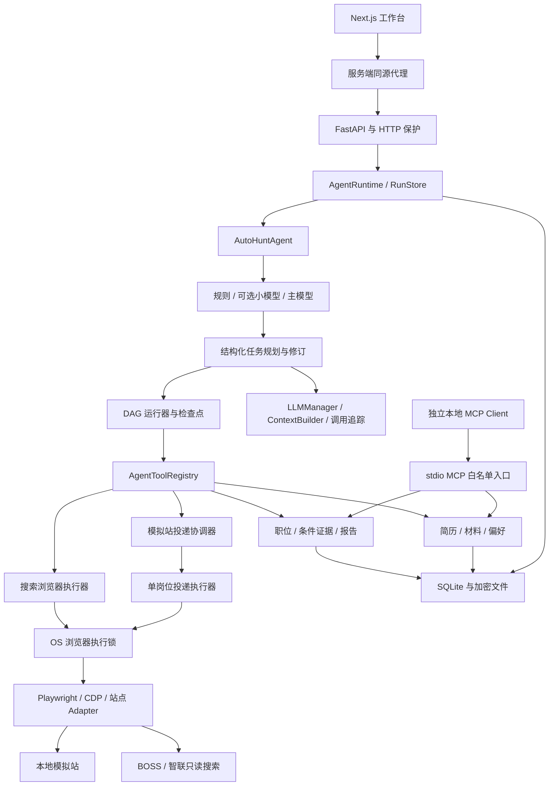
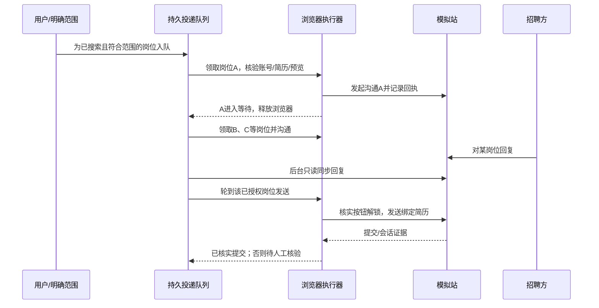

# AutoHunt 详细技术文档

> 定位、功能、架构、技术选型、执行闭环与测试评估。
>
> 文档日期：2026-10-15，时区 Asia/Shanghai。
> 对应源码基线：`ef419a549424f9d36ee0916365c6d82dc59914f0`，分支 `codex/context-ledger-refactor`。
> 改造前回退点：`a82df74ff5496fe36527b1f90ebfed075dea2289`。
> 本文依据仓库实现和已有测试产物整理；不读取或发布个人简历、对话、密钥和招聘账号数据。技术选型理由是对当前实现及取舍的工程解释，不冒充历史上已经记录的 ADR。
>
> 后续实现补充：[2026-10-21：受限恢复、未知投递只读对账与长期语义记忆](recovery-reconciliation-memory.md)。其中更新了本文原有恢复及历史摘要的能力边界；旧版实测数据仍按原日期保留。

## 阅读导航

| 读者目标 | 建议章节 |
|---|---|
| 快速理解项目和边界 | 1—4 |
| 理解 Agent 规划、记忆、执行与授权 | 5—12 |
| 理解搜索、匹配、投递和成长闭环 | 13—20 |
| 理解数据、安全、前端和部署 | 21—24 |
| 查看测试证据、指标、问题和验收方法 | 25—29 |
| 面试介绍与源码导航 | 30—32 |

本文中的“已实现”表示存在对应生产路径；“已验证”必须同时说明验证层级。隔离合约通过，不等于真实模型理解正确，更不等于真实招聘网站端到端通过。

## 1. 项目定位

### 1.1 一句话描述

AutoHunt 是一个本地、单用户、有人类接管能力的求职 Agent：以当前简历和会话搜索条件为基础，执行职位检索、证据化筛选、匹配分析、申请看板管理、本地模拟站沟通与投递，并将岗位差距转化为可审核的成长计划及简历补充提案。

它既不是只返回聊天文本的求职问答助手，也不是已经支持任意招聘网站无人值守投递的通用浏览器 Agent。

### 1.2 面向的问题

1. 求职者需要反复输入自己的技能、经历、岗位方向；长期偏好不容易维护。
2. 搜索、筛选、沟通、等待回复和发送简历跨越多个页面及较长时间，纯聊天无法维护可靠进度。
3. 用户会不断补充条件、改变范围、追加动作、取消分支；一次性静态计划无法覆盖这些变化。
4. 岗位匹配不仅是关键词重合，还涉及薪资单位、用工关系、福利、职责、实习条件及信息不足。
5. 能总结 JD 的系统，不一定能完成投递；能投递的系统，也不一定能证明投递结果。
6. 用户希望将岗位要求与自身经历的差距，转化为可执行学习任务，再经证据和人工确认反馈到简历。

### 1.3 两个主要项目特点

- **从信息处理走向有状态业务执行**：搜索与总结之后，仍维护申请、沟通、HR 回复、发送简历和执行结果；外部副作用必须有范围和回执。
- **以简历作为可理解的长期职业信息入口**：简历及补充材料形成版本化事实，用户可以直接查看和修改；临时搜索条件与其分离，避免一次对话悄悄改写长期偏好。

更准确地说，简历是长期职业信息的重要事实源，并非系统唯一的持久记忆。用户确认偏好、会话槽位、执行检查点、职位证据和历史消息各有自己的存储及生命周期。

### 1.4 当前能力边界

| 能力 | 当前状态 | 不应夸大的部分 |
|---|---|---|
| 模拟站搜索、看板、沟通、回复和发送简历 | 有完整生产路径和多类隔离验证 | 不代表每次真实模型规划都成功 |
| BOSS / 智联搜索 | 存在站点 Adapter 和只读搜索入口 | 当前版本真实站登录、选择器和完整流程仍需获授权验收 |
| 真实招聘网站沟通、上传和投递 | 未开放 | 不能从模拟站支持推导为真实站支持 |
| 动态规划、修订、断点接续 | 已实现，状态驱动合约覆盖 | 不代表任意自然语言和全部故障都已覆盖 |
| 简历与材料解析、提案审核 | 已实现 | 无扫描件 OCR；不是简历事实真实性认证 |
| 跨行业成长计划 | 有统一结构、引用核验和完成反馈 | 质量依赖模型和 JD；规则评分/标签仍有技术岗位偏向 |
| 长期、多轮记忆 | 结构化状态、窗口、抽取式轨迹、关键词历史读取 | 无向量数据库、自动语义长期召回或完善的自动摘要恢复 |
| 多 Agent / 容器沙箱 | 已删除实验实现 | 有并发任务不等于 Multi-Agent；文件保护不等于沙箱 |
| 生产级多租户、分布式高可用 | 未实现 | 当前应绑定回环地址，本地单进程运行 |

## 2. 业务目标与验收标准

项目应按用户目标验收，而不是按“模型有回复”验收。

| 用户目标 | 可以认为完成的依据 | 不足以证明完成的信号 |
|---|---|---|
| 上传简历并作为搜索依据 | 主简历/画像有对应简历 ID 和版本，搜索字段来源可追溯 | 文件上传 HTTP 201 |
| 搜索 N 个符合条件岗位 | 本轮去重、硬条件通过、配额准入的结果数达到 N，或明确报告不足 | 找到 N 个链接；读取 N 个详情页 |
| 给某个职位链接 | 稳定列表引用定位到该岗位，返回记录中的可点击原始链接 | 直接把“第8个”当数据库 ID=8 |
| 按范围自动投递 | 范围内岗位入队、逐个沟通、收到回复后发送，保存提交证据 | 模型说“已投递”；队列返回 queued |
| 暂停并修改条件 | 原任务暂停，未执行参数修订，后续步骤使用修订后的条件 | 只更新前端输入框 |
| 继续失败任务 | 定位旧执行记录，保留已完成回执，只恢复可安全继续部分 | 恢复一个 idle 浏览器；创建无关新计划 |
| 生成成长计划 | 使用指定范围的有效 JD，保存可核对引用、步骤、产物与验收标准 | 输出一段泛泛建议 |
| 完成内容写回简历 | 用户提交真实证据，形成提案，经确认后产生新简历版本 | 点击“完成”就自动认定具备能力 |
| 中断全部操作 | 撤回未完成工作、取消并等待 Worker 退出，保存不确定结果 | 仅断开事件流或关闭网页 |

## 3. 系统组成与部署拓扑

工作区分为两个独立应用，共用一个 Git 仓库：

```text
Job_hunter/
├── autohunt/
│   ├── frontend/       Next.js / React / TypeScript 工作台与同源代理
│   ├── agent/app/      FastAPI、单 Agent、运行层、站点执行器与持久化
│   ├── agent/evaluation/  隔离测试、合成语料与本地评估产物
│   ├── scripts/        启动、验证和模拟职位扩充脚本
│   └── docs/           架构、专项设计、评估与本技术文档
└── mock-site/
    ├── app/            FastAPI + SQLAlchemy，求职者/招聘方业务
    ├── frontend/       模拟招聘静态页面
    └── job_site.db     本地运行数据，不提交仓库
```

本地地址：前端 `127.0.0.1:3000`，Agent 后端 `127.0.0.1:8000`，模拟站 `127.0.0.1:8080`。专用 Chrome CDP 默认配置为 `127.0.0.1:9223`。



需要特别区分：主 Agent 使用 Python `AgentToolRegistry` 调用内部工具；独立 MCP Server 对其他本地客户端开放较窄工具集。**并不是所有内部操作都经过 MCP 传输。**

## 4. 技术选型及其取舍

依赖版本为当前配置声明，不表示本机每个依赖的精确锁定版本，也不宣称是行业最新版本。

| 领域 | 当前选择 | 选择理由与收益 | 代价 / 替代方案 |
|---|---|---|---|
| Web 前端 | Next.js 16.1.6、React 19.2.4、TypeScript 5.9 系列 | 同一工程处理交互页面和服务端代理；类型约束有助于运行事件展示 | 页面仍较大；不是完整设计系统或独立 BFF 平台 |
| 开发打包 | Next dev + Webpack | 避开本机 Windows/pnpm 链接依赖下曾出现的 Turbopack 循环重载 | 本机兼容性取舍，不是对两种打包器的通用性能结论 |
| 包管理 | pnpm 11.19.0 声明 | 统一前端工作区及脚本 | 运行环境必须满足 Node/pnpm 引擎要求 |
| Agent 后端 | Python ≥3.12、FastAPI、Uvicorn | 异步网络/浏览器调用自然；可共用 Python 的文档及模型工具生态 | 仍有同步 SQLite/文件 IO；不应声称全链路无阻塞 |
| 数据契约 | Pydantic 2 + JSON Schema | 统一输入类型、范围、结构化模型输出；方便构造确定性测试 | schema 太严会增加修复；不能把结构合法当语义正确 |
| 编排 | 自定义动态 DAG + 运行记录 | 直接表达搜索依赖、等待、分支修订、投递证据和不确定结果 | 生命周期代码量较大，需维护状态一致性；不是 LangGraph/TaskWeaver 的封装 |
| 任务并发 | asyncio、Lock、Semaphore | 本地低运维成本；按会话串行、按依赖推进 | 无分布式调度、跨机器租约和工作进程容灾 |
| 模型访问 | OpenAI-compatible SDK，Mock/DeepSeek Provider | 将协议调用、配置、脱敏、预算和 trace 集中在模型 Interface | 不等于支持任意模型；响应格式及 reasoning 参数与供应商相关 |
| 意图路由 | 确定性快路径 + 可选分类模型 + 主模型 | 高频控制/读取快速，复杂语义交给模型 | 小模型不是必经层；多目标仍需要规划调用 |
| 浏览器自动化 | Playwright + DOM Adapter | 选择器、可见性/可用性检测、结果证据可测试 | 页面变动需要维护；不是每步截图推理的通用视觉 Agent |
| 浏览器接入 | 专用 Chrome CDP / 托管持久上下文 | 保留登录、支持人工验证码接管 | 浏览器环境是共享资源，不能任意并发点击 |
| Agent 存储 | SQLite + 版本化加密文件 | 本地单用户足够、事务与检查点易复现，免部署外部服务 | 未分库分表、未实现完整迁移体系；不适合直接扩展多租户 |
| 模拟站存储 | SQLAlchemy AsyncSession + SQLite/aiosqlite | 独立表达账号、职位、会话、简历与申请等业务 | 存在非 SQLite 连接配置不等于 PostgreSQL 已验收 |
| 私密数据 | cryptography/Fernet | 简历、配置、凭据和部分内部记录加密保存 | 必须稳定保存数据密钥；不是 SQLCipher 全库加密 |
| PDF/DOCX | pypdf、ZIP/XML 文本抽取 | 本地可控、避免把全文解析依赖远程服务 | 无 OCR；文本提取不等于原版式重建 |
| 事件传输 | SSE over fetch | 服务端单向进度/结果推送足够，支持游标重连 | 不是 WebSocket；断流与取消必须分别处理 |
| 长期会话读取 | SQLite 结构化状态 + SQL LIKE 历史片段 | 先解决事实与对象来源，部署简单、可解释 | 无语义召回、无 embedding/向量索引；同义召回可能不足 |
| 工具互联 | 独立本地 stdio MCP | 提供受限、可复用的本地工具入口 | MCP 不负责理解意图、调度或天然授予权限 |
| 验证 | unittest、合成适配器、临时 SQLite、隔离 Chromium | 能直接断言真实生产模块的状态和持久化结果 | 假模型和合成 DOM 不能替代真实模型及网站验收 |

### 4.1 为什么目前不引入 Redis / 向量数据库

项目首先需要的是：明确哪个状态有效、哪个任务执行过、哪个列表的第8个、哪个简历版本已授权。这些是结构化身份与事务问题，不是相似度问题。

Redis 可用于共享短期状态、分布式协调或缓存，但不能修正错误的 OR 条件、计划归属或重复发送。向量数据库可辅助远期语义召回，但不能作为精确序号、金额和操作权限的事实源。

因此当前将 SQLite 和结构化状态保留为事实源；若未来实测发现历史同义召回不足，可增加混合检索，但应返回原文来源、版本和可验证 ID，而不是把相似片段直接作为执行指令。

### 4.2 为什么不为了简历强行加入 Multi-Agent 与 Sandbox

当前工作流的主要瓶颈是共享浏览器和任务状态，并行多个自主 Agent 不会自动提高完成率，反而增加协调与权限成本。已有的评分并发、后台监测和两个运行槽，不构成多智能体。

系统不执行用户上传代码，因此容器执行沙箱不是现有主链路的必需品。`DataFiles` 的路径、类型、大小和原子写保护有价值，但不应包装成隔离进程/网络的沙箱。未来确需执行不可信代码，再按威胁模型引入。

## 5. 核心对象与状态归属

| 对象 | 负责表达什么 | 关键区别 |
|---|---|---|
| Session / conversation_id | 一段会话的消息、搜索条件及上下文 | 不永久独占某个浏览器窗口 |
| Run | 一次请求或被跟踪的后台任务执行记录 | 有状态、结果、事件和检查点；不是一条模型回复 |
| request_id | 调用方请求幂等身份 | 同 ID 不允许承载不同参数；不是靠文本相同去重 |
| TaskRequest | 用户原始业务需求及后续修订 | 不能被“？？？”或“继续任务”覆盖成新根需求 |
| ActionPlan | 一组目标及依赖步骤 | 指针帮助定位，不代替每个计划自己的执行记录 |
| revision | 计划或搜索状态版本 | 计划修订与搜索状态修订是不同版本域 |
| PlannedStep | 一项工具、参数、依赖及等待信息 | 模型提出执行候选，应用决定是否及何时运行 |
| execution_id | 某步骤一次被领取执行的身份 | 用于将开始、结果及副作用阶段关联到同一尝试 |
| BrowserTask / SearchRun | 一轮站点搜索、候选及漏斗 | “候选数量”不等于“准入结果数量” |
| DeliveryRun | 单岗位投递状态机和固定目标 | 固定岗位、简历、站点与执行结果，不使用聊天里的任意 URL |
| Snapshot | 已展示列表及稳定顺序 | 列表序号映射到真实 ID；与看板后续排序分离 |
| Filter verdict | 条件树和 JD 证据的判断 | pass/fail/unknown 与匹配分独立 |
| ResumeDocument | 当前结构化主简历及版本 | 上传文件、主文档、候选画像是关联对象，不是同一字段 |
| ResumeProposal | 待审核简历修改提案 | 提案生成/完成声明不等于已经写入简历 |
| Execution ledger | 从已有事件与检查点派生的只读执行账本 | 不拥有另一套任务状态，不参与授予执行权限 |

### 5.1 状态应由谁决定

- 用户原句与明确修订决定需求；模型只解释，不独立发明需求。
- 数据库中的步骤、回执及适配器观察决定执行结果。
- 浏览器页面与模拟站记录决定是否确实沟通/发送，不能由 LLM 自述决定。
- 当前简历文档和版本决定发出的内容；当前对话不能悄悄改发另一份简历。
- 可见列表的快照决定“第几个”；相似度不能覆盖精确引用。
- 模型摘要、公开记忆、JD 和历史聊天都是数据，不自动成为当前授权。

## 6. 简历、候选画像与持久求职信息

实现入口：[简历上传存储](../agent/app/memory/resume_store.py)、[候选状态](../agent/app/memory/candidate_state.py)、[主简历工作区](../agent/app/memory/resume_workspace.py)。

### 6.1 上传和解析流程

1. 校验扩展名、大小、内容是否为空。
2. 本地提取文本，保存加密原件和文本。
3. 主简历保留提取原文，不要求模型改写后才能导入。
4. 画像提取器异步调用模型，生成技能、岗位建议、行业及经验摘要。
5. 模型返回的技能还需与简历文本核对；岗位建议仅是推断，不是用户承诺。
6. 激活简历后，更新当前简历 ID 和版本关联，重新准备简历派生的会话岗位方向。

当前简历格式为 PDF/DOCX/TXT/Markdown。单个文件上限1.5 MB，PDF最多30页；抽取文本最多80,000字符。DOCX 使用 ZIP/XML 读取并检查解压规模。扫描 PDF 需要外部先完成 OCR。

画像提取失败时，不编造默认“软件工程师”岗位；保留原件与已识别信息，岗位建议可为空，并提示指定方向或重试解析。

### 6.2 项目、课程和代码材料

项目材料支持文档、代码文件和受限 ZIP。ZIP 只在内存读取允许类型，忽略 `.git`、`node_modules`、构建产物等；最多300个文件、总解压8 MB，并限制单文件及文本读取量。**不将代码解压后执行。**

材料转为候选证据，保留来源、标题、项目方法、技能和成果。新增/替换经历通过简历修改提案落地，不能直接覆盖原项目。部分保守兜底仍使用启发式标题和技术词表，跨行业命名质量需要核对。

### 6.3 三类偏好的优先关系

1. **当前轮明确字段 / 会话条件**：例如这次只看杭州、数量18、月薪15k。
2. **用户明确确认的长期偏好**：例如长期目标岗位、排除词、城市。
3. **简历派生画像**：没有更明确输入时，用模型提取的岗位建议和技能作为基础。

具体岗位方向准备逻辑会优先考虑用户确认的目标岗位；否则在有效简历存在时使用岗位建议，再考虑已确认搜索词。显式会话方向以 `query_source=session` 标识，简历更新通常不替换它；用户明确要求按新简历重建时另行更新。

因此“简历就是全部 preference”是产品表达上的简化。工程上必须区分事实、推断、明确偏好和临时条件，否则更新简历会错误覆盖用户意愿。

### 6.4 简历变化对搜索与统计的影响

- 简历 ID/画像更新时间/主文档版本参与 freshness 标记；即使文字只小改、提取岗位词相同，也应识别到版本变化。
- 简历派生岗位词按新版本准备，但已经明确指定的会话岗位词可继续保留。
- 已保存历史结果不会物理删除；当前统计与分析按简历/搜索任务来源读取。
- 不能推导为“任何简历变化都会自动重跑全部历史 JD 评分”。重新统计、重新筛选和重新匹配是不同动作。
- 已授权发送的简历有独立文档 ID、版本和内容摘要校验；版本变化需要核对，不能默默换附件。

## 7. 意图识别、关键词与模型路由

实现入口：[主 Agent](../agent/app/core/main_agent.py)、[路由](../agent/app/intent/router.py)、[小模型](../agent/app/intent/small_model.py)、[规划](../agent/app/workflow/planning.py)。

### 7.1 规则层承担什么

规则适合完全消费的高频操作：停止、暂停、查看状态、帮助、无新增参数的按现有条件搜索等。它也处理安全模式和精确对象引用的结构。

规则不应看到“找”就把后面整句话当职位词，也不应把“不要外包”中的否定解释成“不要执行”。当前 `shortcut_safe` 仅接受明确的操作型短句；不命中不是拒绝，而是进入路由/规划。

复杂请求不是机械地依次穿过所有层：P0保护先处理；可安全快路直接执行；需要参数语义、多目标或修订时交给完整规划。小模型不是每条消息必调。

### 7.2 小模型承担什么

小模型配置是可选的。没有 key/model 时跳过，降级为规则与主模型。配置后通过 OpenAI-compatible 协议做**意图标签分类**，不负责完整参数抽取或授予投递权限。

优先使用 logprobs 和 top-1/top-2 margin；只有标签或模型自报置信度时，不能将其视为可靠授权依据。默认分类超时2秒，低置信度、错误、超时或熔断进入主模型。

默认 direct confidence为0.90，副作用 margin为0.20，普通直接路由 margin为0.15；这些是分类策略配置，不是模型正确率的实测结果。

### 7.3 主模型承担什么

- 结合当前需求、原任务、条件、结果来源和可用工具解释完整语义。
- 将数量、岗位方向、城市、条件树和分支目标放入结构化参数。
- 区分新任务、补参、条件修改、追加动作和引用已有任务。
- 生成执行候选或计划修订，而非直接操纵数据库及任意网页。

岗位关键词的语义提取交给模型；规则仍用于结构验证、薪资文本单位解析、精确序号归一化及已有参数合并。**不应把“关键词语义由模型负责”误解为系统完全不允许正则。**

### 7.4 模型调用策略

`LLMManager` 复用 Provider 客户端，集中进行边界脱敏、上下文预算和调用追踪。普通 DeepSeek 结构化生成使用 temperature=0；fast任务显式关闭 thinking，详细分析使用详细推理配置。低温不等于绝对确定性。

Mock用于本地交互和确定性测试，不具备真实语义判断能力。模型配置支持项以服务端允许列表为准，不是任意模型/地址接入平台。

## 8. Plan-and-Execute 规划

### 8.1 架构归类

当前主链路是**带动态修订、外部等待和检查点的 Plan-and-Execute**：先生成结构化目标及依赖图，再由应用推进工具步骤。

它不是纯 ReAct。兼容路径仍存在模型原生工具循环，具体站点交互也遵循观察—动作—验证，但不能因此把整个系统描述成纯 ReAct。

### 8.2 计划输入与输出

规划模型可读取当前消息、待补原任务、活动计划、会话条件、结果来源、修订 schema 和工具能力；规划本身没有工具执行能力。

`RequestDraft` 的主要字段：

```text
operation: execute | revise
revision: 可选修订对象
continuation: 是否为接续表达
goals[]: quote / disposition / step_ids
steps[]: id / tool / arguments / depends_on / missing_slots / questions
questions[] / reply
```

`PlannedStep` 还包含 `command_quote`、`scope_quote`、`slot_evidence` 和 `user_requested` 等。它们是解释、审计及结构化动作范围的一部分，不是用户原句必须逐字匹配的密码。

计划最多32步；执行器每批最多领取8步，后续继续推进。不要把“32步计划”“8步批次”“兼容工具循环的调用预算”混成一个限制。

### 8.3 多目标依赖示例

合成请求：找15份工作；正式岗月薪至少15k或面议；实习日薪至少300；85分以上投递；其余中月薪25k以上分析不足并生成成长计划。

概念性依赖如下，不代表一次真实模型运行日志：

```text
必要时更新会话条件
        ↓
启动搜索并等待终态
        ├──→ 本轮搜索报告 / 稳定简表
        ├──→ 选出已满足硬条件且分数≥85的岗位 → 有限投递队列
        └──→ 选出分数<85且月薪≥25k的有效JD → 差距分析 / 成长计划
```

搜索启动后返回 running 不代表下游可以立即用空集合执行。执行器应等待已绑定搜索的有效结果。分支筛选不能反过来抬高整个搜索的薪资门槛。

### 8.4 图规范化

`workflow/graph.py` 处理唯一证据生产者、依赖绑定、直接反向边修复和待执行重复写入合并。

- 成长计划绑定搜索结果，即成长步骤依赖搜索完成，不是搜索依赖成长计划。
- 多个搜索来源都可能满足时，优先显式绑定，否则澄清，而不是任取最新搜索。
- 只修复可无损判断的直接反向边；间接矛盾路径仍需重新规划。
- 仅参数相同不足以去重写操作；还要比较依赖、证据、问题及请求范围，避免跨读写屏障错误合并。

### 8.5 规划修复与超时

当前总规划 deadline为60秒。结构格式允许一次修复，内部语义契约最多3次修复，均在同一总时间内，不是每轮重新获得60秒。

可剥除代码围栏及已识别传输元数据；其他字段仍按 schema核对。修复输入只提供安全错误路径、类别和受控候选数据，不能把模型错误输出升级为新指令。

仍可能因模型延迟、反复修复、大条件树或上下文过长而超时。任务描述和执行记录保留，不把规划超时误报为浏览器搜索失败；该阶段尚未发生点击。

## 9. 执行器、调度与动态任务修订

实现入口：[运行层](../agent/app/runtime/manager.py)、[DAG执行](../agent/app/workflow/execution.py)、[修订](../agent/app/workflow/revision.py)。

### 9.1 并发层次

| 层次 | 当前策略 | 为什么 |
|---|---|---|
| 不同会话请求 | 共享2个运行槽 | 限制模型/IO并发，维持本地资源可控 |
| 同会话推进 | `asyncio.Lock`串行关键区 | 防止条件和计划修订互相覆盖 |
| JD 匹配 | 默认最多4个并发任务 | 浏览器抓取与分析解耦，避免逐岗位等待全部模型结果 |
| 浏览器点击/投递动作 | OS锁串行 | 避免共享页面被两个执行器导航/点击 |
| 多岗位HR等待 | 多条持久等待记录，轮流检查 | 不让第一个HR不回复阻塞所有后续沟通 |

逻辑分支可以独立就绪，但当前 DAG循环并不意味着同一计划所有工具都用 `gather`并发执行。浏览器串行和多个HR同时等待可以同时成立。

### 9.2 一步执行的过程

1. 检查依赖、撤回、会话归属、简历版本和必要参数。
2. 计算动作策略；需要确认则进入等待，而不是先执行。
3. 生成 `execution_id`，将步骤标记为 claimed，并持久化。
4. 调用注册表中的受限工具。
5. 根据工具回执更新 completed、waiting_external、waiting_input、waiting_approval等状态。
6. 发生异常时结合副作用阶段记录 failure，不确定写入进入待核验。
7. 保存计划和事件，再由下次推进处理后续就绪步骤。

claim先于副作用，解决“点击后崩溃，却被认为从没执行过”的重放风险；它本身不证明副作用已经发生。

### 9.3 动态修订 Interface

`RevisionDraft` 支持：

| 字段 | 功能 |
|---|---|
| `plan_id` + `expected_revision` | 针对明确计划进行版本比较 |
| `updates` | 合并未执行步骤参数，可改变允许的依赖 |
| `add_steps` | 追加投递、结果查询、分析等新步骤 |
| `remove_steps` | 撤回尚未执行的分支 |
| `invalidated_steps` | 为可重新计算的已完成读取/分析生成新节点 |
| `pause` | 暂停或继续计划推进 |
| `goals`、`questions` | 更新目标说明及待澄清范围 |

已完成外部动作不能通过改回pending来重做。追加节点若声称要放到已完成步骤“之前”，不能改写历史；应重新计算允许的证据或派生后续工作。

运行中的只读搜索可以暂存 `staged_arguments`，暂停下游；显式接续时先停止并等待旧Worker退出，再按新参数启动/接续相应搜索，旧请求及结果保留。

### 9.4 状态冲突的处理

RunStore保存计划时采用SQLite事务及expected_revision比较；对话中的活动计划是投影，不是唯一执行锁。无关新请求不应仅因改变“当前计划”指针就使旧任务失去后续执行能力。

这不是完整分布式事务：多存储模块、浏览器页面和远程站点不在同一个数据库事务里，因此仍需回执、对账和不确定结果状态。

## 10. 校验、风险和授权

实现入口：[计划校验](../agent/app/workflow/validation.py)、[动作策略](../agent/app/security/decisions.py)、[风险分级](../agent/app/security/risk.py)。

### 10.1 三件事必须分开

1. **解释**：用户想做什么，由模型结合上下文判断。
2. **校验**：工具存在、类型范围正确、依赖图可执行、必要信息完整，由应用检查。
3. **授权**：某个实际动作是否允许在当前范围下执行，是否需要确认，由动作策略与提交模块判断。

MCP或模型返回了工具JSON，不代表以上三者自动成立。JSON只是动作候选，不是业务完成证明或权限凭据。

### 10.2 当前分级策略

- 原话引用改写、空白差异及部分目标注解缺失：记录 warning，不能再凭文字形式一致性一票否决。
- 可修复结构错误：REPAIR；依赖环、来源绑定等可能需要REPLAN。
- 缺真正必要信息、多个目标来源或岗位同名：CLARIFY。
- 动作风险需要确认：REQUIRE_APPROVAL。
- 已取消、越界、不支持的站点发送、撤回权限和不可安全重放：拒绝或保留待核验。

`Decision`包含ALLOW/WARN/REPAIR/REPLAN/CLARIFY/REQUIRE_APPROVAL/DENY，但不应声称每个类别都由一个全能中间件自动解决。不同决策在规划、执行和投递层协同落地。

### 10.3 动作风险

只读通常LOW，可回退本地写入通常MEDIUM，模拟投递等外部副作用HIGH；尚未分类的工具为UNKNOWN，不能把UNKNOWN排序为LOW。

默认使用risk策略、HIGH阈值。本地动作通常无需额外确认；HIGH动作可由已记录、范围匹配的用户请求形成服务端审批记录，否则询问。停止/暂停等控制操作优先处理，不应被复杂语义规划拖住。

用户明确“85分以上自动投递”可以授权有限范围，不需要逐条固定口令；但不能扩大成“以后所有符合岗位永久自动投递”。手动沟通也不等于自动授权系统发送简历。

### 10.4 两类摘要不要混淆

- 旧 `security/action_grants.py` 的参数指纹保留兼容和审计，不再作为通用工具入口凭据；不应描述为模型必须原样传回的授权密码。
- 投递预览中的岗位事实、目标URL、简历版本/内容和payload摘要仍用于防篡改及一次性发送绑定。

历史上出现过内部哈希被错误脱敏后对不上。当前原始内部参数、状态和指纹无损存储，脱敏只在模型、公开日志/API、MCP等输出边界处理副本；不是删掉所有有价值的投递保护。

### 10.5 为什么仍不能保证“正常命令永不受阻”

结构与状态校验无法替代语义判断。模型仍可能把条件分错分支、选错修订方式或找错目标；结构合法也可能理解错误。当前放宽的是容易误拦的形式审查，不是取消业务约束。

未知结果、真正歧义和权限变化应明确让用户处理；降低错误拦截不能以静默扩大投递范围为代价。

## 11. 记忆与多轮上下文

实现入口：[DST](../agent/app/runtime/dialogue.py)、[搜索状态](../agent/app/runtime/search_state.py)、[上下文投影](../agent/app/runtime/memory_context.py)、[预算模块](../agent/app/runtime/context_builder.py)。

### 11.1 记忆分层

| 层次 | 内容与事实源 | 使用方式 |
|---|---|---|
| 长期职业事实 | 当前简历、候选证据、明确偏好 | 生成当前职业上下文，版本化保存 |
| 会话状态 | 搜索条件、字段来源、激活主题、待补槽位 | 多轮继承与增量更新，不反复靠聊天猜全部参数 |
| 原任务锚点 | TaskRequest.original、amendments、overrides、撤回动作 | “继续第一次任务”“我的需求是什么”的可靠依据 |
| 执行记忆 | Run/plan/step/checkpoint/receipt | 决定恢复位置、是否已执行、能否重试 |
| 对象记忆 | Snapshot、selected_job、job_target_context | 决定“第二个”“其余岗位”的目标集合 |
| 近期文本 | 最近完整用户轮次及助手回复投影 | 补充语境，不代替任务事实 |
| 远期轨迹 | 精简trace和抽取式summary | 导航辅助，不是自动生成的长期人格/事实 |
| 历史读取 | SQL LIKE、消息ID和受限片段 | 主模型需要时读取来源，不把命中内容直接当新授权 |

### 11.2 当前DST内容

`DialogueState`维护active_intent、frames、snapshots、pending、tasks、trace、summary、selected_job，以及task_request、instruction_request、learning_request等。

当前容量上限包括：8份快照、每份最多200个条目、8个pending、32条trace、24条summary。近期操作超出trace容量时，只有允许类型的已观察操作进入抽取式summary。

用户“那就90分以下的”应作为已有成长计划请求的范围补充；“第二个”应绑定当前候选选择列表；“我的需求是什么”应回顾原任务，而不是把最近一次规划错误当需求。

### 11.3 生命周期与遗忘

当前代码**不会因为闲置15分钟就清空所有条件**。普通闲置不是用户要求忘记任务；追问、待确认动作及可写快照各自过期。

- 追问默认10分钟，并受4轮距离约束。
- 快照的写操作适用性有时间/轮次/版本限制；只读引用有更宽读取方式。
- 读取旧记录不会自动延长授权或重新激活已撤回动作。
- 显式重置临时上下文会设置history_epoch；原始历史仍保存，不等于删除简历或数据库。
- `compact_state`中的recency_weight用于表示轨迹远近；不能将其宣传成已经实现所有模型上下文的注意力加权算法。

### 11.4 统一输入预算

预算模块将持久化原文与模型输入分开：

```text
固定协议 / 工具schema / 当前用户请求 / 当前完整工具事务
        + 原任务、最新条件、版本与来源引用
        + 可选近期完整轮次
        + 可选历史轨迹和公开记忆
```

默认输入上限取：`min(48,000, 65,536 - 本次输出上限 - 1,024)`个估算token。默认输出8,192，近期历史8轮/6,000，会话投影16,000，分类投影6,000。

估算使用ASCII/3 + 非ASCII×2，不是供应商精确tokenizer。工具schema、系统指令和输出预留参与预算，不能只算聊天正文。

历史按完整轮次选择；超长旧助手报告可替换为明确检索提示，当前任务原句不切片。原生工具调用和对应结果按完整事务保留，不能留下孤立tool_call_id。

若必要状态仍过大，保留内部记录、报告需要分批，不为通过预算删除否定或OR分支。分类输入超预算可交主模型；不意味着主模型窗口无限。

### 11.5 150份岗位是否会撑爆聊天

职位全文存数据库，会话只保存稳定ID、来源、数量、少量预览和当前必要证据。读取某个职位或生成分析时，再取有界集合。岗位总数与每轮模型上下文大小解耦。

注意：当前搜索结果目标字段是1—100，候选预算1—200。150条引用的上下文合约测试，**不是单次搜索150份的功能承诺**；更大目标需明确分批并保持各批来源。

### 11.6 尚存缺口

历史检索是关键词LIKE而非向量相似度；返回最多10条，每条内容受限，不能假装已经完整回看所有历史。远期同义回忆、跨话题复杂指代、自动语义摘要以及窗口溢出后精确恢复，仍需进一步模型评估与设计。

## 12. 失败、重试、暂停与断点接续

实现入口：[重试与watchdog](../agent/app/runtime/resilience.py)、[任务恢复](../agent/app/workflow/recovery.py)、[运行控制](../agent/app/runtime/control.py)。

### 12.1 副作用阶段

`unknown → preparing → started → committed`用于记录操作阶段。只有受信任执行器报告实际阶段，模型不能自行宣布commit。阶段单调推进，不能在发送后通过写回preparing声称尚未操作。

### 12.2 重试与接续不是同一概念

| 场景 | 当前处理原则 |
|---|---|
| 模型纯推理/明确幂等读取发生429、部分5xx、网络错误 | 在有限次数、总deadline内退避重试 |
| 模型输出JSON错误 | 有限格式/契约修复，发生在执行前 |
| 只读工具失败 | 可在安全读取白名单和预算内重试 |
| 已点击沟通/发送但响应丢失 | 先核验；不直接重发 |
| 创建预览前缺少简历或账号 | 记录前置条件未满足，补全后恢复，不假装已发送 |
| 页面关闭/浏览器断开 | 检查现存记录与页面，必要时人工接管，不在后台反复弹窗 |
| 用户暂停后改条件 | 修订未执行参数并暂停后续，继续时按新版本推进 |
| 服务重启 | 恢复排队/观察记录；已经发生的外部写入不自动重放 |
| HR长时间不回复 | 保留等待并后台轮询，不占用持续浏览器锁，不因等待本身认定失败 |
| 用户取消 | 撤回未完成工作，取消并等待Worker退出；不能撤销已经送达的简历 |

纯推理的`safe_retry`最多3次尝试（含第一次），退避约0.4s、0.8s并加随机抖动，上限由实现限制。SDK内置重试关闭，避免与应用重试叠加成不可见的请求放大。

不是所有标为read的工具都自动重试：某些读取会产生快照或焦点，注册表另设安全白名单。

### 12.3 接续决策顺序

1. 定位当前会话的原始任务及持久计划。
2. 用精确工具回执对账claimed步骤，避免已完成动作重复运行。
3. 检查取消、撤回、简历变化、真正未回答的问题。
4. 已完成节点保留结果；等待外部事件的节点恢复观察。
5. 可安全重试的失败读取/准备阶段重新进入pending。
6. 已开始且结果不确定的写入保留待核验，不强行恢复。
7. 终态run保持历史不可变；需要新尝试时保留parent_id和旧回执。
8. 没有计划、此前只在规划阶段失败时，才按保留的原需求重新规划。

当前恢复次数上限为5次，避免“继续任务”无限循环。上下文可辅助定位原任务，**断点在哪里与是否已发送，最终由执行记录而非聊天回忆决定**。

### 12.4 超时体系

| 范围 | 当前默认或约束 | 说明 |
|---|---|---|
| 入队等待 | 120s | 不等同HR等待 |
| Runtime基础chat / plan预算 | 55s / 105s | 实际会按规划、合成及复合任务附加预算，不是统一总耗时承诺 |
| 规划 | 60s | 传输、格式及契约修复共用 |
| 小模型分类 | 2s | 超时降级 |
| Provider请求 | 60s外层 | 应用deadline可更早取消 |
| 常规步骤 | 20s；部分投递/定位45s；成长/重新筛选等180s | 具体依执行器条件分支 |
| JD语义条件 | 25s | 异常变unknown，不靠猜测判通过 |
| 成长计划模型生成 | 150s | 由外层执行预算包裹 |
| 回答合成 | 18s | 失败回退回执，不重新执行工具 |
| 浏览器活跃 / 无进展 / 人工等待watchdog | 900s / 180s / 900s | 实际进展与心跳区别处理 |

HR等待不使用“到期后自动认定失败”的旧策略。保留的reply timeout配置不能被理解为当前仍会把无回复任务在该时刻关闭。

## 13. 通用岗位条件框架

实现入口：[条件树](../agent/app/core/job_filters.py)、[薪资谓词](../agent/app/core/salary_conditions.py)。

### 13.1 不把一切需求压成关键词

搜索关键词用于召回岗位，条件树用于判断岗位是否满足完整要求。公司、用工关系、福利、职责、实习转正机会等应作为条件，而不是全部拼入站点搜索框。

基本表达：

```text
condition: 一项事实要求，可带明确薪资谓词
all: 所有子条件
any: 任一子条件
not: 对单个子表达式取反
mode: require / prefer / allow
```

`require`影响硬准入；`prefer`保留偏好判断但当前没有完整全站软排序；`allow`扩大接受范围，不要求JD证明“用户允许”。“也可以实习”不能变成必须为实习。

当前公开模型schema默认6层，内部组合预算8层，最多256节点，每组合最多32个子节点。应用只做保序、逻辑等价规范化；不会为满足深度限制删除条件，或把异构AND/OR压成平面列表。

### 13.2 三值逻辑

| 组合 | 关键规则 |
|---|---|
| ALL / AND | 有fail即fail；全pass才pass；其余unknown |
| ANY / OR | 有pass即pass；全fail才fail；其余unknown |
| NOT | pass↔fail；unknown仍为unknown |

“没写外包”不等于“确认不是外包”；“某公司客户为华为”不等于“雇主为华为”；“有条件转正机会”不等于“保证转正”。不能仅凭公司名称或字面出现某词完成全部判断。

### 13.3 模型语义判断与确定性核对

模型根据岗位字段给每项条件返回pass/fail/unknown、原因和原文证据。应用核对：

- 返回索引对应真实条件，不可越界或重复。
- 证据字段合法，引用为给定JD中的连续原文。
- 不存在有效证据的pass/fail降为unknown。
- AND/OR/NOT由应用计算，避免模型重复取反。
- 重用旧判断时核对条件、策略版本及原始岗位事实摘要；JD变化不能继续使用旧结论。2026-10-20 起将原始 `source_tags` 与分析/展示标签分开，校招/应届招聘对象与正式/实习性质分别核对；批量补投在授权前展开继承条件。实现和历史兼容细节见[筛选证据复用与补投范围](delivery-evidence-reuse.md)。

这证明“引用存在”，并不自动证明“引用足以支持结论”。模型对雇主关系、保证/机会、必要/充分条件的判断仍可能错，需要独立标注JD评估。

### 13.4 薪资与实习示例

“正式岗月薪至少15k或面议；也接受实习，日薪至少300”应为：

```text
ANY
├── ALL
│   ├── 正式岗位
│   └── ANY(月薪区间下限≥15000, 薪资面议)
└── ALL
    ├── 实习岗位
    └── 日薪区间下限≥300
```

岗位字段的薪资文字由确定性解析器转成monthly/daily/negotiable/unknown。模型负责用户语义及分支，程序负责在同单位中比较数值。日薪不自动乘工作日换算月薪，未明确币种/年薪/时薪等不擅自折算。

区间支持contained或overlap两种口径，默认contained。单说“15k”是最低要求、目标值还是精确值，必须结合上下文解释；真正影响范围的歧义应询问，不能靠无证据默认值蒙混。

下游“只分析85分以下且月薪25k以上”是分析分支条件，不自动变成全局搜索的25k门槛。面议是否可投递也要按当前用户指令单独判断，不能因搜索允许面议就默认允许所有分支。

## 14. 站点搜索与数量准入

实现入口：[浏览器搜索](../agent/app/browser/automation.py)、[模拟站搜索Adapter](../agent/app/browser/mock_site_adapter.py)、[职位存储](../agent/app/jobs/store.py)。

### 14.1 搜索管线

1. 从会话状态/当前简历取得岗位方向，明确平台、城市、数量及条件。
2. 绑定当前简历与search request，创建SearchRun。
3. 获取浏览器锁并连接CDP或托管上下文。
4. 核验登录、验证码、MFA及页面可用性，需要时等待人工。
5. 多查询/城市遍历岗位卡片，统一清洗和去重。
6. 卡片批量初筛；值得读取的岗位进入详情页。
7. 详情页提取JD，有限并发匹配与硬条件证据判断。
8. 通过事务性准入的岗位进入本轮结果；其他候选保留诊断，不全部扩充看板。
9. 生成本轮报告，唤醒绑定该搜索的下游步骤。

### 14.2 四个数量必须分开

- **发现链接数**：DOM解析得到的链接，可能重复或无效。
- **候选预算max_jobs**：最多处理多少候选，当前1—200。
- **目标result_limit**：本轮希望得到多少个去重且满足条件的岗位，当前1—100。
- **新增看板数**：本轮准入岗位中，以前未在看板可见的数量。

目标10个允许为了找到它们读取38个候选，但不能把38个全部当本轮满足条件结果加入看板。结果不足应给出缺口和原因，不用不符合或unknown岗位补数。

### 14.3 分组配额

正式5份、实习5份等请求使用 `result_groups=[{label,count,filters}]`；总目标由各组count相加。最多10组、总数最多100；分组需要硬事实，不能把prefer/allow直接升级为类别事实。

`admit_search_result`通过`BEGIN IMMEDIATE`原子判断候选是否已准入、组余量、总目标、去重和看板可见性，同时写回执。并发分析完成时不会仅靠内存自增导致超额准入。

当前按已验证且未满的分组顺序分配。类别重叠时不是全局最优配额求解器；例如“正式”与“第三方”可能不是互斥类别，业务定义需要模型正确表达或用户澄清。

重新指定总数且未给新分组时，会清除旧分组，避免“再找10个”继续沿用旧的正式/实习配额。

### 14.4 去重与候选保留

模拟站优先以站点与external_id生成稳定键；其他岗位主要以公司、标题、地点归一化后哈希去重。另有JD内容及审阅事实指纹用于版本判断，不是语义向量去重。

这种方法简单可解释，但不同站点同一职位、名称变化和同名多岗位仍可能误合并/漏合并，应在真实站验收时测量。soft removal保留已移除记录，后续重新筛选不能悄悄复活。

## 15. 匹配评分与筛选的区别

实现入口：[规则分析](../agent/app/jobs/analysis.py)、[模型初筛与匹配](../agent/app/browser/screening.py)。

### 15.1 当前检索不是向量检索

| 问题 | 当前方法 |
|---|---|
| 去哪里找岗位 | 站点搜索关键词与DOM Adapter |
| 这条JD是否符合不要外包等要求 | LLM语义证据判断 + 条件树 |
| 月薪/日薪是否过线 | 类型化单位和区间比较 |
| 与候选人匹配多少分 | LLM匹配 + 规则评分兜底 |
| 之前某段对话在哪里 | SQLite LIKE与来源消息ID |

没有embedding索引、向量近邻召回或reranker训练，不应在简历中写“基于向量数据库的职位RAG检索”。

### 15.2 两阶段匹配

卡片初筛可一批一次fast调用；明显不相关、明确排除或失效的跳过。初筛调用失败时回退为REVIEW并读取详情，而不是丢掉全部岗位。

详情匹配使用当前搜索方向、简历技能、目标岗位和JD，默认最多4并发。模型不可用或输出错误时使用确定性分析；若当前搜索方向一致，规则避免仅因技能稀疏而把所有岗位排除。

规则评分组成：搜索方向50分、可识别技能覆盖30分、目标岗位10分、JD信息完整度10分。一般≥80建议APPLY，50—79 REVIEW，低于50 SKIP；本轮方向明显不符会限制上限，明确排除词优先。

规则技能表和角色概念明显偏技术领域，不能据此声称跨行业评分都同样可靠。LLM采用相同权重指引，也不是严格逐项数学计算或经校准的录用概率。

### 15.3 决策分层

`匹配88分`不覆盖`硬条件unknown/fail`；`APPLY建议`不等于提交授权；`有授权`不代表页面已解锁；`按钮点击成功`不等于简历已送达。

这四个分离让一个模块失败时可以定位，而不是统一返回模糊的“无法执行”。

## 16. 浏览器自动化与动态网页

实现入口：[会话](../agent/app/browser/session.py)、[锁](../agent/app/browser/lock.py)、[页面生命周期](../agent/app/browser/lifecycle.py)、[投递Adapter](../agent/app/delivery/mock_site_adapter.py)。

### 16.1 BrowserSession

- auto模式先尝试专用Chrome CDP，失败时可以使用托管持久上下文。
- 显式CDP连接失败会报告，不暗中换任意用户日常窗口。
- 登录人工接管保留上下文，并在继续时重新收集证据。
- 后台监测可静默连接已有CDP，不新建页面、不激活窗口，也不循环拉起关闭的浏览器。
- 初始用户交互请求与后台监测的浏览器启动权限不同。

专用keeper标签可能使用 `about:blank#autohunt-keeper`维持CDP窗口；应区分有意的生命周期标签与无意义重复打开的空白页。

### 16.2 页面变化和异步加载

站点Adapter使用版本化选择器、URL规范化、DOM状态、可见/可用控制以及页面观察来操作。流程需要区分loading、登录、验证码、聊天面板遮罩、回复未到、发送按钮未解锁和已发送。

明确页面状态优先于固定sleep。保留截图、URL、选择器版本和登录证据用于诊断。未知字段、验证或页面结构不符合预期时，转人工接管或停止，不通过反复点击碰运气。

当前主要是站点专用DOM自动化，**没有证明可以泛化处理任意动态表单、任意弹窗或所有React页面变化**。新增站点需要自己的Adapter及测试。

### 16.3 共享浏览器锁

搜索和投递共享数据根上的OS文件锁；Windows使用msvcrt，其他环境使用fcntl。进程退出由OS释放锁，锁文件存在不代表有存活任务。

不能通过删除锁文件“解决占用”，也不能让两个不同数据根连接同一CDP而绕开互斥。会话拥有的是任务记录和操作范围，不是永久独占Chrome窗口。

## 17. 模拟站自动投递闭环

实现入口：[协调器](../agent/app/workflow/mock_coordinator.py)、[公平规则调度](../agent/app/workflow/delivery_rules.py)、[单岗执行器](../agent/app/delivery/automation.py)、[简历绑定](../agent/app/delivery/resume_binding.py)。

### 17.1 目标流程



“快速”是尽快完成一个岗位的沟通再处理下一个，而不是等待第一个HR回复后才处理第二个。实际浏览器动作依旧串行；多个岗位在业务上同时等待回复。

### 17.2 一次性预览与简历绑定

每次发送绑定岗位ID、源URL/执行目标、动作、岗位事实、简历document_id、版本及digest。授权令牌只消费一次，授权消费与DeliveryRun创建事务化。

UI点击单岗位“投递”或明确范围命令可以在内部完成预览与一次性授权，不要求用户看见单独预览页面。但“无需单独预览页面”不等于后端没有预览快照。

当前执行器只支持本地模拟站提交；即使调低风险确认阈值，也不能因此启用真实站发送。

### 17.3 回复轮询与后台实现

协调器默认30秒周期；有queued岗位时可用更短调度间隔推进沟通，但不是对外站无限高频轮询。模拟站回复同步使用本地只读API，不改变未读状态；发送仍经过浏览器和受控授权流程。

已同步的HR回复可以唤醒后续发送条件，但仍需检查是否有有效授权、账号/简历是否一致，以及页面按钮是否解锁。看板显示回复只证明已观察到消息，不单独证明已经允许发送。

等待HR不设置业务上的强制截止；停止服务时无法持续主动轮询，重启后按已有记录和安全状态处理。后台不会为监测不断弹出新窗口；已有浏览器不存在或需验证时应报告人工接管。

### 17.4 看板阶段与事实

| 后端stage | 当前主要界面含义 | 事实依据 |
|---|---|---|
| review | 待审核/人工核验 | 岗位已进入看板，尚未完成授权执行或需核实 |
| applying | 等待回复 | 已发起沟通，等待HR或继续申请 |
| waiting | 已投递 | 已核实发送，等待后续进展 |
| interview | 面试 | 后续明确阶段 |
| outcome_indeterminate | 待审核·结果待核验 | 发送结果不明确，不允许直接重放 |
| rejected | 已拒绝/不继续 | 用户或业务结果记录 |

英文历史字段名称不等于中文直译，尤其 `waiting`在当前看板表示已投递。部分统计文字仍可能使用旧标签，应以本轮回执及阶段事实为准，而非孤立文案。

### 17.5 不确定结果保护

发生“点击发送后超时”“连接丢失，不知是否提交”等情况时，系统必须核验已有记录，不能先把它当作失败重发。最多一次的本地令牌、幂等记录和结果核对降低重复风险，但不应宣称跨浏览器和外站实现了数学意义的exactly-once。

## 18. 单岗位定位、候选选择与移除

实现入口：[引用归一化](../agent/app/runtime/job_references.py)、[目标定位](../agent/app/core/job_targets.py)、[结果来源](../agent/app/workflow/result_sources.py)、[候选选择UI](../frontend/components/job-target-choices.tsx)。

精确序号、唯一名称可确定性定位；复杂职责/公司/地点描述使用受限候选中的模型判断和证据。列表序号不能变为全局数据库ID；“13的链接”与“ID:13”有不同语义。

同名/多个可能岗位时返回候选卡片，用户可点击选择；提交包含choice_id、step_id、expected_revision及真实job_ids，服务端核对归属和版本。也保留文字“第二个”的交互方式。

“投递某个岗位，其他都移除”的安全依赖是：

```text
job_target_resolve → 冻结选中ID和原始范围
        ├──→ job_remove_selection(exclude_target_step_id=定位步骤)
        └──→ mock_delivery_start(target_step_id=定位步骤)
```

没有完成选中对象确认时，不能先按整个公司名猜保留集合，也不能提前删除其余岗位。移除是soft removal：移出看板、取消选中岗位未完成投递，保留JD、沟通及已发送历史。

`job_results_refilter`只重新计算已有证据和准入，不等于移除；重新搜索也不是移除工具的替代品。

## 19. 搜索总结、统计与回答合成

实现入口：[搜索报告](../agent/app/jobs/search_reporting.py)、[回答合成](../agent/app/workflow/presentation.py)、[运行发布](../agent/app/runtime/manager.py)。

### 19.1 为什么有程序渲染，而非全部交给LLM

模型适合解释和综合；稳定序号、原始链接、真实数量、已入队/已发送和失败状态必须来自记录。否则模型可能重排条目、混入别的分支或把执行日志误解为最终成功。

当前使用无工具回答合成调用，输出sections及来源ID。应用核对来源范围，再渲染真实链接、简表和动作回执。合成失败时回退已记录结果，不重新调用投递工具。

### 19.2 去重发布

搜索报告绑定task_id，不取全局“最近任务”。前台/后台发布使用步骤、execution_id、结果及回执指纹去重；同一次结果不重复输出，新尝试或新结果仍应展示。

显示过的简表序号固定，后续“第8个”不按看板当前评分顺序重新解释。为成长分析读取的背景列表，不应被自动当作用户要求的全量结果再输出一遍。

### 19.3 统计口径

- 单搜索漏斗记录links_seen、cards_parsed、unique_jobs、limited、visited、filtered、stored、duplicates、errors、cancelled等。
- 本轮符合条件数可包含已有看板职位；因此不等于新增看板数。
- 自动化概览、当前看板库存、当前简历搜索画像及特定分析分支的样本，不应混成一个分母。
- 中断/失败前已经可靠记录的结果可以保留；未读取的链接不计入已核实JD画像。
- 文案总结不是统计事实源，统计应从绑定的SearchRun/职位记录计算。

例如分析“85以下、25k以上”时，应报告该分析步骤自己的`job_sources`、`score_scope`和`salary_scope`，不能展示一份包含88分岗位的通用简表并让用户误以为全都参与了分析。

## 20. 岗位差距、成长计划与简历回写

实现入口：[成长计划](../agent/app/growth/plans.py)。

### 20.1 生成条件及输入

生成是显式动作：页面按钮或完整/多轮继承的用户指令。需要有效主简历与对应搜索的有效JD；没有数据时不以泛泛建议冒充已完成计划。

当前最多读取20份有效JD；可按task_id、min_score/max_score及salary_min限定。新任务按简历ID关联，旧未绑定任务只允许受限兼容回退；不把全库任意JD加入计划。

成长服务还存在业务层文本投影：当前渲染简历截取约12,000字符，每份JD约1,400字符。因此统一ContextBuilder保留的是**已经交给模型的投影**，不是声称所有模块都再无文本截取。超长简历/JD可能遗漏相关内容，这是后续分页证据读取的改进点。

### 20.2 计划结构

每个Gap包含：

- 类别：technical_skill、internship_direction、domain_knowledge、professional_skill。
- 优先级、JD原文引用和岗位来源、简历引用及判断依据。
- 目标、前置知识、预计投入2—200小时。
- 3—8个具体步骤、实践任务与交付物、2—5条验收标准。
- 简历写回目标skill/project/none及完成证据。

一个计划最多8个Gap。步骤长度和去重约束提高具体性，但“科学”仍需依据先修关系、实践反馈及人工审核评价，不能只由字数证明。

### 20.3 引用和能力判断

JD引用需要在当前输入的原文片段中核对；没有有效引用的Gap不保存。简历引用不成立时降为`resume_not_shown`，不能据此写“候选人不会”。

这不是对全文总结每句话的形式证明；计划summary、学习顺序和业务解释仍可能存在模型偏差。模拟模型不生成详细跨行业计划。

### 20.4 学习完成到简历反馈

1. 用户提交真实完成证据；状态为`completed_user_reported`，不是系统认证。
2. 技能类补充生成简洁技能标签，避免过细堆砌。
3. 项目类要求真实项目名及更完整证据，由模型整理项目摘要、架构/方法、技能、成果和优化。
4. 通过数字、技能及来源等约束，避免明显编造；约束不等于能认证所有成果。
5. 生成ResumeProposal，由用户确认后写入主简历并产生新版本。
6. 已批准技能可同步匹配画像；不自动把每一个技能标签改成新的职位搜索词。

### 20.5 闭环究竟闭在哪里

业务链为：`简历事实 → 岗位证据 → 差距 → 学习/实践 → 完成证据 → 人工确认提案 → 新简历版本`。

它闭合的是数据与工作流反馈，不是“自动学习后模型参数更新”，也不是“自动证实用户掌握技能”。新简历对下一轮匹配是否真正改善，需要版本对照实验验证。

## 21. 数据模型、事务与隐私

### 21.1 数据分工

| 存储 | 主要内容 | 注意事项 |
|---|---|---|
| `autohunt.db` | 职位、搜索、候选、沟通/投递、会话消息、成长计划、审阅/移除与自动化记录 | SQLite业务库不是整体加密；包含私人历史，不能提交仓库 |
| `runtime.db` | 会话、运行、计划检查点、事件、审批记录及接续关系 | 配置data key时敏感JSON字段加密；不是所有列或整库都加密 |
| `router.db` | 路由事件、规则版本、澄清记忆等 | 不等于长期语义向量记忆 |
| `private/candidate-state/` | 当前候选画像、结构化偏好 | 加密、版本及来源 |
| `private/resume-workspace/` | 主简历、history、proposal | 加密；旧版本保存不代表已有一键恢复UI |
| `private/resumes/`、`private/materials/` | 上传原件及文本 | 加密；不自动运行文件 |
| memory / skills文件 | 受限长期事实及技能指令/提案 | 不存密钥和联系方式；不是自动进化系统 |
| 浏览器profile/截图/lifecycle | 登录态及诊断证据 | 可能含私人页面内容，需本地保护和保留策略 |
| `mock-site/job_site.db` | 模拟账号、职位、消息、简历、申请及表单答案 | 模拟身份与数据，不能公开为真实招聘 |

### 21.2 事务的用途

- 请求幂等：同会话request_id对应同内容，防止重放或参数替换。
- 计划CAS：revision比较并持久化，避免旧观察器覆盖新修订。
- 搜索准入：在一个事务里检查去重、配额和总目标。
- 一次性发送：令牌消费和DeliveryRun创建原子化。
- 移除：记录目标并撤销相关未完成工作，不删除审计链。

SQLite事务不跨越浏览器动作。系统因此使用“先记录claim、后执行、再核验”的近似事务模式；不能把它称为跨站分布式事务。

### 21.3 按需脱敏

内部请求参数、状态和授权摘要保持完整。跨模型、公开API/诊断和MCP输出时处理副本，避免误改执行事实。

明确的联系方式、已知密钥格式和敏感字段会遮蔽；薪资、数量、日期、公司名、普通ID与哈希通常保留。判断依靠类型字段与模式规则，不使用LLM判断是否脱敏。

这是数据最小化机制，不是完备DLP。姓名、地址和未知密钥样式未必全被识别；发送外部模型仍需遵守数据范围和用户同意，不能因为“有脱敏”就无限发送全文。

## 22. 运行账本与可观测性

实现入口：[trace](../agent/app/llm/tracing.py)、[诊断上下文](../agent/app/runtime/context.py)、[ledger](../agent/app/runtime/ledger.py)。

### 22.1 关联链

```text
request_id / session_id
  → run_id（可关联parent_id）
    → plan_id / revision
      → step_id / execution_id
        → model call_id / tool_started / tool_finished / effect_phase
```

后台评分任务继承固定的诊断作用域，不因为共享RunContext的当前动作改变而被记到其他步骤。只有模型请求、响应、重试及预算等被动事件可走诊断入口；不能借此改变会话、checkpoint或取得授权。

### 22.2 日志记录什么

- 入站请求ID、方法、路径、状态及耗时；审计日志不应记录完整密钥和私人请求正文。
- 路由层、分类置信来源、熔断变化。
- 规划候选、解析/校验反馈、修复次数及对应模型调用身份。
- 工具参数、执行身份、耗时、回执、失败类型及副作用阶段。
- 浏览器选择器版本、URL、证据、漏斗原因。
- Provider、实际返回model、usage、latency与错误类别；不记录隐藏推理正文。

详细内部模型记录沿用加密存储；未配置加密时，仅保留受限诊断元数据。公开运行输出不返回完整checkpoint、prompt和草稿。

### 22.3 账本 Interface

后端：`GET /api/v1/runs/{run_id}/ledger?include_parents=true`。
现有前端run代理可转发相应两段路径：`/api/agent/runs/{run_id}/ledger`。

默认读取单run；可包含同会话parent链，最多32层，循环/超限显式标记。账本是事件投影，查询本身不修改执行状态或重放动作。

### 22.4 成本与延迟口径

有usage才统计token；缺失为null，不是0。已知token可报告子合计，但同时报告完整性。

Provider未给费用、又没配置/注入价格表时，total_cost保持未知。通过`model_rates`可注入含币种的输入/输出/缓存价格，结果标记为估算而非账单，不硬编码会过期的实时模型价格。

模型调用按逻辑调用记录，传输重试另计；最终一次usage不能代替响应丢失前一次的账单。并发模型耗时相加不是用户任务墙钟耗时，HR等待也不是模型推理时间。

独立文档调用若没有RunContext，不会自动归到某个任务；投递子任务也不因parent链查询就自动汇总所有业务关联。账本不是完备供应商账单系统。

## 23. 前端、HTTP保护与MCP

### 23.1 前端的责任

工作台包含对话、简历/材料、看板、成长计划、统计及运行状态。`useAgentRuntime`管理会话、运行、SSE连接、忙碌/停止状态、审批及候选选择。

服务端代理从环境读取`AUTOHUNT_BACKEND_TOKEN`并附加后端鉴权头，浏览器端不拿到该Token。选择的会话ID可保存在localStorage，它不是服务端权限凭据。

页面仍以大型page.tsx为核心，部分运行、候选选择和简历渲染已拆出；拆分粒度、错误边界和可访问性仍有优化空间。

### 23.2 SSE与重连

后端事件带单调seq；客户端使用after游标读取并去重，断线有限重连，必要时回读终态快照。后端无事件时发heartbeat；客户端另有低频运行状态刷新。

**断开SSE只表示停止观察，不等于取消后端任务。** 停止按钮和明确停止指令必须调用服务端控制入口；关闭浏览器标签也不能冒充发送已撤销。

当前SSE是应用轮询数据库后推送，不是数据库原生CDC；多客户端会增加读取开销。

### 23.3 HTTP保护

当前入站主要经过：CORS → TrustedHost → SecurityHeaders → RequestId → Audit → RateLimit → BodyLimit → ApiKey → HistoryMaintenance → 路由/Pydantic。

默认写/普通API限流60次/分钟，认证读取另有600次/分钟配置；request body主要基于Content-Length限制2MiB。它不是完整的流式上传大小防护，也不是分布式限流系统。

系统只做本地单用户服务Token鉴权，Next代理没有完整终端用户登录/租户权限体系。即使Token未泄漏，也不应直接公开到互联网。

### 23.4 MCP的实际作用

MCP通过stdio向本地客户端注册18个白名单工具，涵盖memory、候选画像、偏好提案、简历读取/提案、skills提案、职位结果/统计、浏览器状态和给定JD分析。

MCP没有shell、任意文件、任意URL、真实投递或简历提案批准工具。输出通过边界脱敏；内部执行参数不因输出副本而改变。MCP提供协议互操作，不替代规划、校验、授权和执行器。

## 24. 模拟站、定时任务、启动与维护

### 24.1 为什么保留独立模拟站

模拟站可控制职位、用工关系、薪资、账号、HR回复、简历解锁和表单，能够复现超时、未回复、验证、重复发送和页面变化，不需要用真实招聘方测试副作用。

求职者与招聘方可用不同浏览器上下文登录。网站使用本地模拟身份头校验角色，并非生产认证系统；拥有API、静态页面与数据库也不代表它是外部站点的完整等价复制。

数据库采用固定应用根路径，避免启动cwd变化导致创建空库。模拟站SQLite启用WAL、busy timeout、外键等；包含非SQLite连接池分支，但未据此宣称已部署生产PostgreSQL。

职位扩充脚本生成的模板岗位可用于规模/流程测试。岗位库存数量不是独立真实JD标注样本数；本文不读取私人运行库来公布当前库存数量。

### 24.2 定时任务的当前实现

协调器有显式启用的每日任务设置，按Asia/Shanghai时间检查daily_time，并用数据库当日claim避免重复调度。服务没有运行时不会执行，也没有系统级常驻唤醒保证。

当前每日分支主要面向默认会话和模拟站：从画像/偏好取有限岗位词与城市，使用既有dry_run/有限联系范围，不是把任意多目标会话完整编排为通用cron任务。

因此它适合本地MVP演练，不是已经完善的分布式定时调度平台。所谓dry_run可能在模拟站实际发送消息或简历，并非零副作用预演。

### 24.3 本地启动

已有环境不要重写.env或更换数据密钥。在仓库根分别启动：

```powershell
# 终端1：Agent API
cd autohunt/agent
.\.venv\Scripts\python.exe -m uvicorn app.main:app --host 127.0.0.1 --port 8000 --env-file .env

# 终端2：从仓库根进入autohunt
cd autohunt
pnpm --dir frontend dev --hostname 127.0.0.1

# 终端3：模拟站，从仓库根进入mock-site
cd mock-site
.\.venv\Scripts\python.exe -m uvicorn app.main:app --host 127.0.0.1 --port 8080
```

各命令用于独立终端，不是依次在同一目录执行。前端.env.local中的后端Token应与Agent鉴权配置一致。真实模型测试、搜索和投递不是检查服务是否启动的必需步骤。

不再提供/恢复已移除的health业务接口；本地可通过端口、网页、受保护只读接口和启动日志判断状态。401可证明鉴权入口存活，但仍需经前端代理确认实际连通。

### 24.4 清理与备份

临时历史清理入口由配置开关控制，清理前本地备份；有任务/上传冲突时不清理。简历、材料、条件、对话、看板、成长计划和模拟站历史分别有明确定义，模型配置/密钥和职位库等可保留。

模拟站数据库需要明确本地路径，未配置时不能猜测并清理其他库。历史清理、上下文重置、岗位移除、取消任务是四种不同操作。

### 24.5 部署限制

当前多个运行器和协调器是进程内单例。不要直接启动多个Uvicorn Worker或多个不同数据根共用同一CDP。若要扩展，需要先设计共享状态、租约/fencing、抢占、跨进程事件和外部动作对账，而不是只加worker数量。

## 25. 测试分层与现有证据

### 25.1 五个验证层级

| 层级 | 回答的问题 | 不能证明什么 |
|---|---|---|
| 静态检查 | 语法、类型、构建是否正常 | 自然语言理解或业务闭环 |
| 确定性合约 | 给定参数/状态，生产模块是否按契约推进 | LLM是否会正确产生这些参数 |
| 真实模型合成评估 | 模型在合成表达/JD上理解与判断如何 | 浏览器点击和实际发送 |
| 隔离DOM/浏览器测试 | 生产Adapter在受控页面上是否操作正确 | 完整模拟站后端或真实站稳定性 |
| 完整模拟站E2E | 用户请求→真实模型→真实浏览器→站点最终状态 | 真实BOSS/智联页面及反自动化环境 |

应报告每层证据，不用一个笼统“Agent准确率”覆盖所有部分。

### 25.2 已核对的当前合约结果

2026-10-14的22模块回归：639项通过、0失败、0错误。明细如下：

| 合约模块 | 项数 | 主要关注 |
|---|---:|---|
| context_ledger_contract | 108 | 预算、近期历史、工具成对、诊断关联、账本隐私与未知费用 |
| model_trace_contract | 10 | 模型请求/响应关联、加密及公开投影 |
| workflow_execution_contract | 18 | 阶段、等待、独立分支、修订与执行 |
| loosening_contract | 190 | 校验分级、布尔组合等契约 |
| approval_contract | 25 | 范围审批、变更与复用限制 |
| goal_graph_contract | 11 | 目标、依赖和证据方向 |
| action_contract | 20 | 工具动作、参数与执行隔离 |
| command_recovery_contract | 18 | 多轮修订和持久接续 |
| recovery_contract | 23 | 恢复决策和执行安全 |
| salary_revision_contract | 16 | 薪资分支和运行中修订 |
| condition_refresh_contract | 9 | 重新筛选与条件证据 |
| result_source_contract | 12 | 当前简历/搜索来源绑定 |
| search_delivery_contract | 25 | 搜索数量、分组与定向投递 |
| job_target_contract | 29 | 语义/精确目标定位与移除 |
| job_choice_contract | 23 | 歧义选择和保留/移除依赖 |
| reference_flow_contract | 20 | 裸序号、多操作与稳定最终结果 |
| presentation_contract | 22 | 回答合成、分支范围与兜底 |
| reporting_contract | 14 | 报告口径及去重发布 |
| privacy_contract | 14 | 内部原值、边界副本和隐私 |
| delivery_scheduling_contract | 13 | 快速沟通、公平轮转和等待释放 |
| background_polling_contract | 15 | 后台只读监测与浏览器行为 |
| special_salary_contract | 4 | 特殊薪资格式 |
| **合计** | **639** | **离线合约；不是639个真实用户端到端成功任务** |

另有229项状态驱动多轮场景全部通过，外部模型调用0、实际浏览器运行0、真实提交0。新增108项中包含72个上下文参数组合，不应当作72个独立人工标注语义案例。

HTTP账本边界脱敏补核后，108项新合约再次全部通过；这个复跑不能再加一次到覆盖规模中。

### 25.3 证据在哪里

测试源码和合成规格在 [evaluation](../agent/evaluation)；本地未提交产物：

```text
agent/evaluation/results/context-ledger-regression/20261014T130742.820449Z/
agent/evaluation/results/stateful/20261014T130836.139182Z/
agent/evaluation/results/context-ledger/20261014T131401.970558Z/
```

回归产物包含summary、逐测试日志、合成事件/轨迹和源文件指纹；状态场景另外记录案例、期望/实际、失败分类及耗时。它们是本地证据，不提交个人运行数据到GitHub。

既有评估文档还保留更早的合成规格与少量真实模型评估；那是历史版本和历史预算，不能相加成当前版本实测通过数。当前639/229没有新的真实LLM调用，也不宣称最新分支完整浏览器E2E已通过。

### 25.4 为什么很多测试通过，用户仍能遇到问题

过去相当一部分测试给定了已经抽取正确的JSON或脚本模型输出，验证的是下游执行契约。它们能发现配额、状态与授权错误，却不能证明真实模型面对省略、错别字、多分支时会产生正确计划。

其他差距包括：固定fixture缺少真实任务演化；只断言回复包含某句而不核对数据库；合成DOM与实际站点不同；没有覆盖介入时机；测试收集重复继承用例造成数量误导。

当前回归收集器按模块实际声明的测试收集；失败产物保留。后续仍需要以真实failed case和完整环境最终状态为oracle，不能用扩大随机prompt数量替代。

## 26. 测试如何复现与补足

在 `autohunt/agent`运行：

```powershell
# 新上下文与账本专项
.\.venv\Scripts\python.exe -m evaluation.context_ledger_contract

# 当前22模块离线回归
.\.venv\Scripts\python.exe -m evaluation.context_ledger_regression

# 动态任务 / 多轮 / 介入 / 恢复的状态场景
.\.venv\Scripts\python.exe -m evaluation.stateful_scenarios
```

静态检查入口为 [verify.ps1](../scripts/verify.ps1)，涵盖后端编译、前端类型/构建等。老evaluation.run中的部分断言仍对应旧授权契约，应查看其失败说明，不能把“整个历史suite全部通过”写进结论。

### 26.1 状态驱动压力测试

测试应组合三类维度，而不是只生成越来越长的一句话：

- **表达**：多目标、AND/OR/NOT、修订、指代、省略、撤销、继续、查询而非执行。
- **介入时机**：规划中、待审批、搜索进行中、结果未完成、等待HR、已发送、结果不确定。
- **变化**：改参数、追加步骤、取消分支、换简历、换会话、刷新旧证据、选择歧义目标。

每条场景包含初始状态、步骤序列、故障注入、允许的工具轨迹、禁止动作和数据库最终状态。特别要断言停止后是否还有发送、是否误保留整个公司、是否把序号当ID、是否超额扩充看板。

### 26.2 真实模型评估

需要新的明确同意：说明发送给哪个供应商、哪些数据、最多多少次**物理请求**。默认使用虚构指令、虚构简历摘要和JD，不发送个人材料、不调用招聘工具。

建立人工审核的gold目标/条件树/对象集合，测试集与调试集分开；同一表达重复运行测稳定性。修复调用和传输重试也应计费/计预算，不能只统计顶层规划一次。

### 26.3 完整模拟站E2E应补的门禁

推荐最小验收覆盖，但本文未宣称它们已全部在最新分支执行：

1. 新会话上传合成简历→复杂搜索→准确数量/配额→报告与统计一致。
2. 语义排除且JD信息不足→unknown不自动发送。
3. 多岗位快速沟通→全部独立等待→不同顺序HR回复→准确简历发送。
4. 单岗位序号/公司描述→歧义点击确认→只操作指定ID。
5. 保留一岗、移除其余→移除范围与队列取消一致。
6. 搜索中追加投递、暂停后修改薪资→新版本正确接续。
7. 发送前/发送后故障→可重试与不确定结果区别正确。
8. 规划、沟通、等待回复阶段重启→已完成内容不重放。
9. 生成差距→提交实践证据→人工接受提案→简历版本变化。
10. 停止会话/停止全部→服务器终态、浏览器Worker、队列和站点消息共同验收。

E2E使用独立数据根、专用浏览器和模拟账号，并断言模拟站messages/applications/resumes中的最终事实；不与个人正在运行的队列共享。

## 27. 成功率、错误率与执行成本

### 27.1 推荐指标及分母

| 指标 | 定义/口径 |
|---|---|
| 完整目标覆盖率 | 正确表达所有用户目标的请求数 / 可判定请求数 |
| 参数与条件正确率 | 逐字段/条件结构与人工gold一致，单独统计分支和单位 |
| 多轮条件保留率 | 应继承字段未丢失的多轮场景数 / 需要继承场景数 |
| 合法请求误拦截率 | 本可执行却被系统错误拒绝的动作/请求 / 合法可执行集合 |
| 未授权动作放行率 | 应拒绝/确认却执行的动作数 / 未授权测试集合 |
| 筛选质量 | pass/fail/unknown的precision/recall及混淆矩阵 |
| 证据引用正确率 | 引用真实且足以支持结论的判断数 / 需证据判断数；区分文本存在与语义充分 |
| E2E成功率 | 所有要求的业务最终事实满足的场景数 / 适用场景数 |
| 重复发送率 | 同一已授权业务意图的不当重复发送 / 发送意图总数 |
| 停止后残留动作 | 确认停止之后仍发生的未授权外部动作数 |
| p50/p95延迟 | 分别统计路由、规划、模型、浏览器动作及任务完成；不混入HR主观等待 |
| 调用与成本 | 物理请求、修复/重试、已知usage、费用完整性及每成功任务成本 |

失败样本应按输入理解、参数/分支、结构校验、审批、状态/依赖、浏览器、站点、回答展示、基础设施分类，不能全部归因于“LLM不行”。

### 27.2 成本结构

一轮任务的模型调用大致由：规划 + 卡片批次初筛 + 每详情匹配 + 语义条件判断 + 成长计划 + 回答合成 + 有界修复/重试构成。

候选预算、每份JD长度、条件复杂度和重新筛选会影响成本。规则控制快路径、批量初筛、最多4路匹配、已有证据重用、fast调用及输出上限用于控制开销；并发降低等待不等于降低token费用。

当前没有最新完整E2E统计支持“成功率99%”“节省80%成本”“每轮固定几秒”等数字。账本提供采集基础，真实结论需要在固定语料、模型、版本及环境下重复测量。

## 28. 完整闭环的证明方法

### 28.1 正向闭环

```text
原任务和修订有来源
  → 计划目标 / 参数 / 依赖正确
  → 执行器领取并持久化
  → 站点事实满足筛选和目标数量
  → 看板、报告、统计口径一致
  → 有范围的沟通和发送
  → 站点与本地均有对应提交事实
  → 差距分析使用正确JD集合
  → 实践证据与人工简历提案形成版本反馈
```

### 28.2 负向闭环

同样要证明：无简历/方向不猜测、无证据不放行、错误账号不发送、取消后不继续、结果不确定不重放、模型故障不伪造完成、没有JD不生成虚假差距。

不能只演示成功路径；“正确暂停并解释缺少什么”也是流程闭环的一种终态，但不能计为已投递成功。

### 28.3 推荐演示证据包

用一组虚构简历、固定JD、独立模拟站数据和固定版本，保留：用户输入、结构化条件、plan/revision、工具轨迹、run ledger、SearchRun漏斗、站点最终申请/消息记录、成长计划引用和简历diff。

展示时能从同一run_id解释“为什么做这一步”“为什么没发”“从哪恢复”，比只放一段流畅录屏更能证明工程闭环。录屏可以辅助复现，不应替代现场代码及结果证据。

## 29. 当前缺口与改进顺序

| 优先级 | 问题 | 建议验收条件 |
|---|---|---|
| P0 | 最新分支真实模型+完整模拟站E2E证据不足 | 固定场景多次运行，目标/轨迹/数据库最终状态均验收 |
| P0 | 多轮语义、分支条件和对象定位仍可能出错 | 用真实failed case转为gold多轮评估，不只给定正确JSON |
| P0 | 动态任务、审批、队列和页面多事实源仍有复杂性 | 故障注入、版本冲突、停止后残留动作及重启回执对账 |
| P1 | 长材料投影、历史片段和远期语义召回有限 | 有界证据分页、明确省略、按来源召回，防止遗漏关键条件 |
| P1 | 跨行业评分及技术词表偏置 | 人工跨行业JD集合、分行业指标和未知比例 |
| P1 | 页面变化和站点Adapter维护 | 独立DOM契约、最新模拟站E2E；真实站只读另行授权验收 |
| P1 | 大型前端页面、统计旧标签 | 领域拆分、单一阶段展示映射、报告/统计一致性测试 |
| P1 | 可观测成本仍有unknown及关联缺口 | 覆盖所有出站入口，明确价格与retry账单，不猜零成本 |
| P2 | 定时任务只覆盖有限本地默认场景 | 明确补跑/重复策略、持久触发和任务范围，不隐式扩大授权 |
| P2 | 多用户/分布式扩展 | 用户身份、租户隔离、共享状态及fencing设计后再扩容 |

当前最值得优先做的是主链路稳定性和证据，不是为关键词增加规则或堆砌multi-agent/sandbox标签。

## 30. 面试时如何准确介绍

### 30.1 约一分钟介绍

“我做了一个本地求职Agent，主要解决简历偏好维护和搜索之后的执行闭环。它不是只总结JD：在可控模拟招聘站中，会维护搜索、筛选、沟通、HR回复和发送简历的状态。整体采用单Agent的动态Plan-and-Execute，复杂语义由模型解释，应用负责依赖、状态和副作用控制。简历和证据是版本化事实，会话条件独立保存，岗位条件用AND/OR/NOT和三值证据判断。执行前保存claim和检查点，已开始但结果不确定的发送不自动重放。测试分为确定性契约、状态多轮、模型评估和模拟站E2E，当前能拿出合约和状态场景日志，但不把这些数量包装为真实网站成功率。”

这是基于当前能力的表达模板，不包含尚未测得的效率或成功率。

### 30.2 常见技术追问

| 问题 | 核心回答 |
|---|---|
| 为什么不是一个大prompt？ | 长等待、动态修订、外部副作用和重启需要持久状态，不应靠模型重复推测 |
| 为什么不是纯ReAct？ | 多目标依赖与恢复需要显式计划；局部观察/工具循环仍可存在 |
| 为什么不用现成框架？ | 当前需精确处理领域回执、简历版本和投递不确定结果；自定义实现可控但有维护成本，不宣称框架无价值 |
| 正则还在做什么？ | 控制/读取快路、对象结构、单位和类型，不用来证明任意自然语言意图忠实度 |
| MCP负责参数抽取吗？ | 不负责；模型依据工具schema给参数，MCP只是独立受限协议入口 |
| 为什么不引入Redis？ | 先解决事实源和事务；缓存不能修正计划或范围语义 |
| 为什么不引入向量库？ | 精确状态、序号、金额与授权不是相似度问题；语义召回可作为补充 |
| 为什么浏览器不能全并发？ | 共享页面会相互导航/覆盖；模型分析可并发，HR等待可并存，浏览器动作串行 |
| 为什么还要校验和授权？ | 区分结构有效、业务范围允许和操作实际成功；去掉形式误拦不等于允许错简历或重复发送 |
| 怎么证明闭环？ | 按run保存目标、轨迹、站点最终状态、报告和后续版本证据，不只看回复文本 |
| 测了很多为什么还出错？ | 给定正确计划的合约不能证明模型会生成正确计划；必须另测真实模型多轮和完整环境 |
| 自动完成学习就写入简历吗？ | 用户真实证据→提案→人工接受→新版本，不做自动资格认证 |

### 30.3 不应写入简历的表述

- “支持BOSS和智联全自动无人值守投递”。当前真实站发送未开放。
- “基于Redis/向量数据库的长期记忆”。当前没有该实现。
- “多智能体并行自主招聘系统”。当前为单Agent，异步任务不等于多Agent。
- “容器级安全沙箱”。当前只保留普通文件保护。
- “868个端到端任务全部成功”。639/229是不同层次的离线契约/状态场景。
- “匹配分就是录用概率”或“模型计划完全可信”。都未被证实。

## 31. 关键配置与Interface速查

### 31.1 配置类别

| 类别 | 主要配置 |
|---|---|
| 数据/身份 | AUTOHUNT_DATA_ROOT、AUTOHUNT_API_KEY、AUTOHUNT_DATA_KEY |
| 前端代理 | AUTOHUNT_BACKEND_URL、AUTOHUNT_BACKEND_TOKEN，仅服务端 |
| 模型 | AUTOHUNT_LLM_PROVIDER、AUTOHUNT_LLM_MODEL、DEEPSEEK_API_KEY；另有加密BYOK |
| 可选分类模型 | AUTOHUNT_ROUTER_SMALL_API_KEY / BASE_URL / MODEL |
| 上下文 | AUTOHUNT_CONTEXT_WINDOW_TOKENS / INPUT_TOKENS / OUTPUT_TOKENS / RESERVE_TOKENS |
| 历史投影 | AUTOHUNT_CONTEXT_HISTORY_TURNS / HISTORY_TOKENS / SESSION_TOKENS / ROUTING_TOKENS |
| 审批策略 | AUTOHUNT_APPROVAL_POLICY=risk或always；AUTOHUNT_APPROVAL_THRESHOLD |
| 浏览器 | AUTOHUNT_BROWSER_HEADLESS、AUTOHUNT_BROWSER_CDP_URL |
| watchdog | AUTOHUNT_ACTIVE/IDLE/HUMAN/CONFIRMATION_TIMEOUT_SECONDS等 |
| 维护 | AUTOHUNT_HISTORY_RESET_ENABLED、AUTOHUNT_MOCK_HISTORY_DATABASE |

只提供名称和模板，不复制本机.env值。配置变更是否需要重启以装配/缓存位置为准；部分Settings在模块加载时读取，不保证热更新。

### 31.2 主要HTTP能力

以下路径均相对后端，仅为主要能力分组，不替代schema；[完整路由源码](../agent/app/api/application.py)为准。

| 领域 | 主要路径 |
|---|---|
| 会话与搜索状态 | `/api/v1/conversations`、`/{session_id}/search-state`、`/{session_id}/context` |
| 创建/查询运行 | `/api/v1/runs`、`/api/v1/runs/{run_id}` |
| 事件/步骤/账本 | `/api/v1/runs/{run_id}/events`、`/steps`、`/ledger` |
| 取消/恢复/确认 | `/api/v1/runs/{run_id}/cancel`、`/resume`、`/approval`、`/target-choice` |
| 范围停止 | `/api/v1/runs/control/stop`、`/api/v1/runs/cancel-all` |
| 模型配置 | `/api/v1/llm/config`；连接测试为独立POST，不是读取即调用模型 |
| 简历与材料 | `/api/v1/resumes`、`/api/v1/materials`、`/api/v1/documents/ingest` |
| 主简历与提案 | `/api/v1/resume-documents/master`、`/api/v1/resume-proposals`及approve/reject |
| 偏好 | `/api/v1/candidate-state`、`/api/v1/preferences` |
| 搜索与浏览器 | `/api/v1/browser/search`、`/api/v1/browser/tasks/...` |
| 职位和投递 | `/api/v1/jobs`、`/{job_id}/deliver`、`/{job_id}/delivery-preview`、`/api/v1/deliveries/...` |
| 协调器 | `/api/v1/mock-workflow/settings`、`/api/v1/mock-workflow/sync` |
| 统计 | `/api/v1/automation/stats`、`/api/v1/insights` |
| 成长计划 | `/api/v1/learning-plans`及`/{plan_id}/gaps/{gap_id}/complete` |
| 记忆与Skills | `/api/v1/memory`、`/api/v1/skills`、`/api/v1/skill-proposals` |

## 32. 源码与进一步阅读

| 主题 | 权威实现/说明 |
|---|---|
| 装配与配置 | [dependencies.py](../agent/app/core/dependencies.py)、[config.py](../agent/app/core/config.py)、[配置模板](../agent/.env.example) |
| HTTP生命周期/路由 | [application.py](../agent/app/api/application.py)、[middleware.py](../agent/app/core/middleware.py) |
| 请求入口与工具Interface | [main_agent.py](../agent/app/core/main_agent.py)、[agent_tools.py](../agent/app/core/agent_tools.py) |
| 意图/可选分类 | [router.py](../agent/app/intent/router.py)、[small_model.py](../agent/app/intent/small_model.py)、[circuit.py](../agent/app/intent/circuit.py) |
| 规划、图和校验 | [planning.py](../agent/app/workflow/planning.py)、[graph.py](../agent/app/workflow/graph.py)、[validation.py](../agent/app/workflow/validation.py)、[contracts.py](../agent/app/workflow/contracts.py) |
| 执行与修订 | [execution.py](../agent/app/workflow/execution.py)、[revision.py](../agent/app/workflow/revision.py)、[manager.py](../agent/app/runtime/manager.py) |
| 状态与恢复 | [store.py](../agent/app/runtime/store.py)、[recovery.py](../agent/app/workflow/recovery.py)、[resilience.py](../agent/app/runtime/resilience.py) |
| 动作策略与历史指纹 | [decisions.py](../agent/app/security/decisions.py)、[risk.py](../agent/app/security/risk.py)、[action_grants.py](../agent/app/security/action_grants.py) |
| 记忆与预算 | [dialogue.py](../agent/app/runtime/dialogue.py)、[search_state.py](../agent/app/runtime/search_state.py)、[memory_context.py](../agent/app/runtime/memory_context.py)、[context_builder.py](../agent/app/runtime/context_builder.py) |
| 模型与账本 | [manager.py](../agent/app/llm/manager.py)、[deepseek_provider.py](../agent/app/llm/deepseek_provider.py)、[tracing.py](../agent/app/llm/tracing.py)、[ledger.py](../agent/app/runtime/ledger.py) |
| 岗位条件与配额 | [job_filters.py](../agent/app/core/job_filters.py)、[salary_conditions.py](../agent/app/core/salary_conditions.py)、[result_groups.py](../agent/app/core/result_groups.py) |
| 对象与序号 | [job_targets.py](../agent/app/core/job_targets.py)、[job_references.py](../agent/app/runtime/job_references.py)、[target_selection.py](../agent/app/workflow/target_selection.py) |
| 抓取与评分 | [automation.py](../agent/app/browser/automation.py)、[screening.py](../agent/app/browser/screening.py)、[analysis.py](../agent/app/jobs/analysis.py) |
| 真实站Adapter | [boss_adapter.py](../agent/app/browser/boss_adapter.py)、[zhaopin_adapter.py](../agent/app/browser/zhaopin_adapter.py) |
| 浏览器生命周期 | [session.py](../agent/app/browser/session.py)、[lifecycle.py](../agent/app/browser/lifecycle.py)、[lock.py](../agent/app/browser/lock.py) |
| 自动投递 | [mock_coordinator.py](../agent/app/workflow/mock_coordinator.py)、[delivery_rules.py](../agent/app/workflow/delivery_rules.py)、[automation.py](../agent/app/delivery/automation.py)、[mock_site_adapter.py](../agent/app/delivery/mock_site_adapter.py) |
| 职位事实与报告 | [store.py](../agent/app/jobs/store.py)、[search_reporting.py](../agent/app/jobs/search_reporting.py)、[presentation.py](../agent/app/workflow/presentation.py) |
| 简历与材料 | [resume_store.py](../agent/app/memory/resume_store.py)、[candidate_state.py](../agent/app/memory/candidate_state.py)、[resume_workspace.py](../agent/app/memory/resume_workspace.py)、[material_store.py](../agent/app/memory/material_store.py) |
| 成长计划 | [plans.py](../agent/app/growth/plans.py) |
| 前端运行交互 | [use-agent-runtime.ts](../frontend/lib/use-agent-runtime.ts)、[agent-runtime.ts](../frontend/lib/agent-runtime.ts)、[运行面板](../frontend/components/runtime-panel.tsx)、[候选选择](../frontend/components/job-target-choices.tsx) |
| MCP | [server.py](../agent/app/mcp/server.py)、[tools.py](../agent/app/mcp/tools.py) |
| 模拟站 | [README](../../mock-site/README.md)、[database.py](../../mock-site/app/database.py)、[auth.py](../../mock-site/app/auth.py) |
| 测试说明 | [evaluation.md](evaluation.md)、[上下文与账本试验](context-ledger-refactor.md)、[动态状态修复验证](stateful-evaluation-2026-10-13.md) |

### 维护原则

以后改变工具Interface、状态转换、条件语义、发送行为或测试口径时，更新本文对应章节；旧评估结果保留版本与日期，不用新结果覆盖失败历史。

本文的目标不是宣称项目已经完美，而是让读者能够从需求追到实现、从实现追到证据，并明确下一步需要验证什么。
