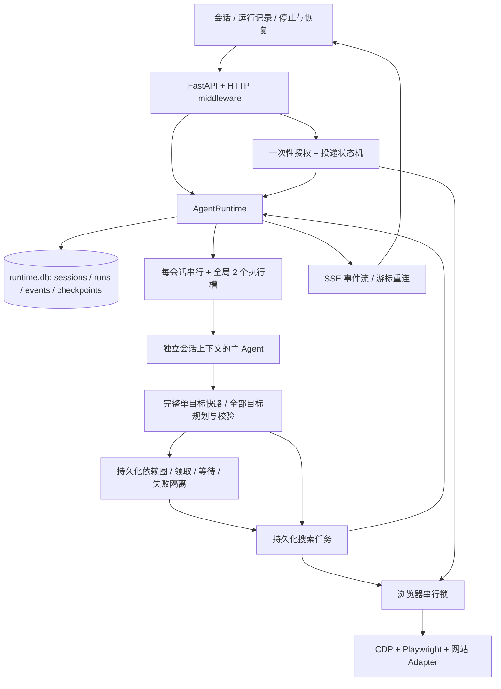

# 会话与统一运行层

更新：2026-10-08。面向本地单用户、单后端进程；运行记录可跨进程重启保存。

## 调用关系

聊天、学习计划和旧异步职位分析接口使用统一运行队列。直接启动搜索和人工授权的投递绑定到运行记录，由监控任务同步状态。原 `TaskBroker` 类保留为未接入主流程的实验模块，API 不再使用其内存队列。

## 会话与任务

- 会话 ID 持久化，页面可创建与切换。每个请求使用独立主 Agent 会话上下文；同会话按提交顺序执行，不同会话最多两个分析执行槽。
- 简历、求职偏好和职位库仍是单用户共享数据，不是每个会话一套候选人资料。模型读取最新结构化偏好，历史聊天不替代它。
- 完整去敏历史保存到 SQLite；会话级 DST、可追溯精简轨迹、预算化历史与按关键词检索共同管理上下文。详细生命周期与评估说明见 `context-management.md`。
- `request_id` 在同会话内唯一。同 ID、同内容返回原任务；同 ID、不同内容返回 409。页面断线重连不会重新提交请求。
- 全局最多保留 100 个非终态运行；队列等待默认最多 120 秒，普通聊天执行预算 55 秒；直接学习计划预算 105 秒，含计划/待补请求的聊天最多 140 秒（规划35秒+执行预算）。依赖执行单步：普通20秒、成长计划100秒；计划内部模型等待仍为90秒。多步骤仍受总预算约束。
- 登录、人工审核、等待 HR 回复不占分析执行槽，不占模型执行预算；用户可停止这些等待。等待有独立期限，见下方故障策略。

## 状态和事件

运行状态：`queued`、`running`、`waiting_user`、`waiting_confirmation`、`waiting_reply`、`cancelling`、`completed`、`cancelled`、`timed_out`、`interrupted`、`failed`、`outcome_indeterminate`。终态不能重新变为运行；恢复创建关联的子运行。

步骤事件保存请求进度、模型调用、工具开始与完成、工具拒绝、浏览器/投递状态、确认请求、回复和搜索摘要。模型推理内容不进入用户事件流；检查点也不通过公开接口返回。

新复杂请求先生成完整规划 JSON，不逐 token 执行半成品；前端展示规划、工具及逐步等待状态。旧检查点的原生工具调用保留流式恢复兼容。展示文本按完整文本单位脱敏；学习计划 JSON 校验后返回完整计划。

## 取消和恢复

停止聊天或学习计划会取消后台协程，并关闭正在读取的模型流；关闭页面只断开订阅，任务继续且可重新查询。

停止搜索会取消其工作协程，保留部分职位并将摘要保存到所属会话。停止投递监测不删除已经确认的投递；发送动作已经开始但结果未确认时标记 `outcome_indeterminate`，禁止重放。

新请求每步执行前持久化 claim。已完成步骤不重复；恢复时 claimed 标为未知结果，后续依赖跳过。搜索/提案等待从已绑定对象恢复；独立未执行步骤仍检查当前计划、简历版本和授权期限，不重放未知写入。旧只读原生循环保留历史检查点恢复兼容。

重启时只自动重新排队未开始的请求；已保存响应补齐会话消息，消息使用运行 ID 去重。确认提案和等待回复恢复为等待；搜索沿用现有策略安全停止并保留部分结果。不会恢复一个未经确认的提交动作。

## 工具故障、有限修复与看门狗

共享实现为 `runtime/resilience.py`，注册表是统一工具拦截层：授权/调用预算 → schema/业务前置检查 → 执行 → 结构化错误和事件。不是允许模型插入任意 middleware 的插件执行框架。

- 错误码区分 `invalid_arguments`、`permission_denied`、`rate_limited`、`service_unavailable`、`connection_failed`、`timeout`、`execution_failed`。记录是否开始执行、结果是否不确定、尝试次数、退避与工具总耗时。授权拒绝不能通过修复/改参数绕过。
- 仅明确白名单的幂等读取重试；结果列表/对象解析/简历读取会产生引用快照，不能因标成 read 就自动重放。暂时性连接故障、408/429/500/502/503/504、请求超时最多尝试3次（含首次），退避0.4/0.8秒加0–0.2秒抖动；校验、权限、缺参数和未知错误不重试。重试仍受原步骤/运行总 deadline 约束。
- DeepSeek 纯推理和流创建可使用同一重试策略，总请求预算60秒；开始收到流之后不重放。规划所有尝试和修复共同限35秒，不额外延长；没有切换到未经配置的备用模型。
- 模型 JSON/字段结构错误最多修复1次，在任何工具执行之前完成。修复输出重新经过用户原话、授权、参数、目标覆盖、依赖图等全部检查；授权不成立、循环依赖、未知工具不会触发此修复。只读整数参数允许一次无损编码修复（如 `"8"`→`8`），不补缺值、不放宽范围、不修复副作用参数。同一引用/参数的重复写步骤拒绝执行。
- 写入/外部执行器开始后，无论 ValueError、网络异常还是超时，无法确定结果即 `outcome_indeterminate`，不自动重试。模拟演练投递中取消也保存未知提交结果。持久化 claimed 步骤在恢复时不重放；前置失败跳过依赖步骤，独立分支可继续。

看门狗观察实际阶段、URL、计数和检查点，不以 `updated_at` 或重复心跳刷新进展。默认配置：

| 环境变量 | 默认 | 范围 |
|---|---:|---|
| `AUTOHUNT_ACTIVE_TIMEOUT_SECONDS` | 900秒 | 单次浏览器搜索/投递检查的累计主动执行时间，排除人工等待 |
| `AUTOHUNT_IDLE_TIMEOUT_SECONDS` | 180秒 | 主动执行期间无语义进展 |
| `AUTOHUNT_HUMAN_TIMEOUT_SECONDS` | 900秒 | 连续人工接管/暂停等待 |
| `AUTOHUNT_REPLY_TIMEOUT_SECONDS` | 86400秒 | 自投递任务创建起的总生命周期上限，跨轮询与重启保持 |
| `AUTOHUNT_CONFIRMATION_TIMEOUT_SECONDS` | 86400秒 | 自简历提案创建起的确认等待，超期不自动接受 |

浏览器超期取消并等待 worker 清理后才释放占用，保留部分结果/已确认投递；未知提交要求人工核验。运行观察器发现失去执行器的任务时安全结束，不把历史记录当作活跃锁。周期监测不是死循环：每次协调动作限120秒，连续失败3次后退避60秒，后续增至最多300秒；成功后复位。协调器重启后故障计数重新建立，但已消费授权/派发状态仍在数据库，不重放写入。

局限：这是 asyncio 协作式超时，不是 OS 级沙箱；同步阻塞代码和拒绝取消的依赖无法保证硬实时中断。暂未提供按用户界面配置期限或跨进程全局熔断。配置修改需重启后端。执行步骤展示重试、修复、错误码和等待超期原因。

本轮验证使用隔离的内存假模型/工具及故障注入，覆盖重试耗尽、取消传播、无进展/人工/主动时间预算、校验前后错误分类、单次修复、DAG依赖失败和恢复不重放；同时做Python语法和TypeScript检查。不触碰真实用户数据，不执行浏览器搜索、沟通或投递。按既有要求没有新增测试源/fixture/runner，目前仍无自动化回归套件；真实模型延迟与真实页面验收另做。

## 接口

| 接口 | 用途 |
|---|---|
| `GET/POST /api/v1/conversations` | 列出 / 创建会话 |
| `GET /api/v1/conversations/current?conversation_id=...` | 会话历史 |
| `POST /api/v1/runs` | 创建聊天或学习计划任务，返回 202 |
| `GET /api/v1/runs?conversation_id=...` | 会话运行记录 |
| `GET /api/v1/runs/{id}` | 查询状态、结果、恢复能力 |
| `GET /api/v1/runs/{id}/events?after=...` | SSE 事件游标续接 |
| `GET /api/v1/runs/{id}/steps?after=...` | 分页读取已保存步骤 |
| `POST /api/v1/runs/{id}/cancel` | 停止运行及绑定的浏览器或投递任务 |
| `POST /api/v1/runs/{id}/resume` | 继续人工接管 / 核对回复 / 恢复安全只读检查点 |

旧聊天和学习计划接口保留兼容入口，内部执行通过统一运行层。Next.js 提供同源代理，模型凭据和后端 Token 不发送到浏览器。

## 验证范围

### 搜索请求解析与筛选

规则承担高频命令：结果查询、统计、停止/恢复，以及能完整解析的岗位/城市搜索和会话条件修改。“找15份信用风险分析师的工作”和模板式组合“搜索风控分析师，数量15个，薪资14k以上”也直接执行，无需小模型或主模型。规则必须完整消耗输入；无法解释的描述、简历/专业引用和复合任务交给主模型。搜索意图已经明确、仅缺参数解析时跳过分类小模型，避免无用串行调用。意图分类置信度不能代替参数完整性验证，任何 direct/澄清路径均不能将整句话当作岗位关键词。所有快路径均保留 P0 安全拦截。

### 会话搜索状态与上下文

每个会话在 `runtime.db/session_search_state` 保存独立条件：最多 5 个岗位词、城市、结果数量、最低月薪、候选预算、方向来源、简历版本指纹和条件版本。优先级为当前明确条件 → 会话条件 → 用户确认的长期偏好 → 当前简历画像。普通对话只调整会话条件，不写入长期偏好。

“换成杭州”“数量改20个”“月薪14k以上”“关键词改为信用风险分析师、金融分析师”只修改对应字段，不隐式重启搜索；“重新搜索”继承当前会话条件。“不限城市/不限薪资”明确清除限制。关键词从简历推导时，简历变更后更新方向；明确指定的会话岗位方向保留，可用“恢复简历方向”回到简历/已确认偏好的默认方向。网页运行面板可查看、重置本会话条件。

会话维护最近最多 20 条 / 18,000 字符文本；主模型工具循环实际历史注入预算为 6,000 字符，另有分区结构化状态与工具 Observation 预算，总消息体上限 40,000 字符。小模型只在规则未匹配时接收当前输入、DST、条件和精简最近 4 条历史，总预算 4,000 字符。小模型低置信度或副作用意图区分度不足时交给主模型，而不是仅凭分类标签让用户选路由。搜索启动后记录条件版本和固定参数快照，后续聊天调整不会改变运行中的任务。

工具增加 `search_state_read` / `search_state_update`：会话状态更新不是浏览器授权，不消耗外部副作用许可；重复同一更新不递增条件版本。会话状态事件通过 SSE 同步前端。新会话不继承旧会话的临时条件，刷新与后端重启保留已有条件。

接口：`GET /api/v1/conversations/{id}/search-state` 查看条件；`POST /api/v1/conversations/{id}/search-state/reset` 重置条件。重置与会话请求串行互斥，处理中的请求返回 409；不会取消正在运行的浏览器任务。

`job_search_start` 支持 `result_limit`（目标符合条件的唯一职位数，含看板已有结果）、`salary_min`（元/月，区间下限）和 `max_jobs`（候选预算，最多 200）。明确的数字数量与最低月薪由执行层保护，不能被模型遗漏或放宽；不写入持久化偏好。薪资未知、面议、日薪不能当作满足月薪下限。复杂请求中无法表达的筛选条件必须说明，不得声称执行。

模拟网站通过可见“下一页”按钮收集多页职位，最多 17 页 / 单关键词城市组合；读取预算和最终结果数量分开。完成报告统计本次已记录的职位，包含重复命中，列出数量缺口、薪资、招聘类型、福利和 JD 摘要。零结果不再误报“JD 未明确标注”。任务条件与筛选跳过原因存入浏览器事件，原生工具参数存入运行步骤。

回归覆盖会话隔离、会话内排序、并发准入、重复请求、SSE 游标续接、分片参数、流取消、分片隐私文本、超时与排队过期、重启不重放写入、只读工具检查点、确认恢复、部分搜索摘要及投递中断。

这次验证不包括真实 DeepSeek 的网络延迟、BOSS 真人验证或真实招聘平台投递；仍需在配置模型后测实际延迟，并使用本地模拟网站完成浏览器端验收。
