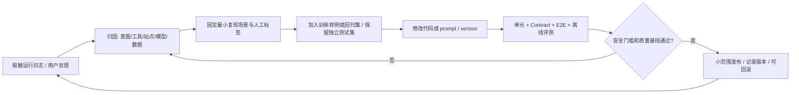

# 测试评估闭环与项目交付标准

更新于 2026-09-18。目标不是证明“网页能点”，而是证明**该做的动作做对、不该做的动作不发生、失败可解释、结果可核验**。

## 1. 可执行验证入口

在仓库根目录运行：

```powershell
# 后端单元/组件回归 + 前端生产构建
.\scripts\verify.ps1

# 完整本地验收：再运行临时数据库的真实浏览器集成测试
.\scripts\verify.ps1 -Browser -MockRoot C:\job_agent
```

依赖：前端已 pnpm install；`agent/.venv` 已安装 `.[dev]` 和 Playwright Chromium；模拟网站目录包含 `app/main.py` 和可用 `.venv`。脚本不会安装环境或清除实际用户缓存。

单元 JUnit：`.runtime/verify-*/unit.xml`。浏览器 JUnit/服务器日志/证据：`agent/test-results/browser-*/`。失败返回非零状态；不加 `-Browser` 会明确提示未做浏览器验收。构建使用 `.next`，与前端开发服务器并行可能互相干扰，正式发布检查建议停止开发服务器或使用独立 checkout。

`tests/conftest.py` 在 API/MCP 单例导入前设置临时数据根、临时加密密钥和 Mock 模型，禁用真实模型凭据。浏览器测试另外启动随机回环端口的模拟站进程及独立 SQLite，只使用合成账号；不污染 8080 正在使用的数据库。

## 2. 本次实际证据

- 审查初始回归：164 passed / 10 skipped。
- 修复后的第一次模拟浏览器回归：46 passed，94.49 秒；其中 10 个实际浏览器参数化用例，其余为相关组件/适配器回归。不是 46 个不同网站测试。
- 前端生产构建通过，包含 Next.js TypeScript 检查。
- 最终统一脚本结果见本文末尾“最终复验”；不要把不同批次的测试数相加当作独立测试覆盖率。

已覆盖：原始简历保持、补充项目接受/编辑、部分提案和版本冲突、文件解析/ZIP 边界、偏好与意图、原生工具循环、MCP 白名单、密钥/隐私、评分硬排除、锁竞争及异常退出、DOM fixture、浏览器登录/MFA 接管、直接/沟通型投递、回复持久化、提交后响应丢失核验、不确定结果禁重试、页面关闭与 CDP detach；并覆盖 SearchRun/DeliveryRun/Conversation 重启恢复、run_id 查询、搜索漏斗、简历快照授权绑定和绑定变化拒绝。

**本次没有做**：使用真实 DeepSeek 的质量/成本/延迟评测、向真实 BOSS HR 沟通或投递、公网渗透测试、长时间无人值守、多用户隔离、全前端点击与多页 PDF 视觉矩阵。当前浏览器 E2E 主要验证执行器和模拟站，不等于“从 AutoHunt 对话 UI 到模型再到统计”的所有链路已覆盖。

## 3. 测试分层

| 层 | 固定输入 | 必须检查的输出 | 运行时机 |
|---|---|---|---|
| 单元 | 纯文本/JSON、Fake LLM、临时文件 | 意图、策略、评分、提案差异、脱敏、去重和授权规则 | 每次改动 |
| Contract | 版本化 BOSS/模拟站 HTML fixture | 职位 ID/标题/城市/JD、验证状态、按钮权限，不依赖坐标 | Adapter/selector 改动 |
| API/组件 | 隔离数据库与服务、确定性工具响应 | HTTP 权限、字段约束、状态迁移和版本冲突 | 每次提交 |
| 浏览器 E2E | 临时模拟站/合成 HR 和求职者 | 真实 click、消息、申请、数据库记录、未知状态无重发 | 发布前必跑 |
| 全链路产品 E2E（待补） | AutoHunt 对话 + 可控模型 + 模拟站 | 搜索命令→看板→沟通→人工 HR 回复→简历按钮→报告→统计对账 | 发布门槛 |
| 模型离线评估（待补） | 冻结测试集、固定模型/prompt/tool schema | 工具选择、事实忠实度、匹配质量、延迟和成本 | 模型/prompt/阈值变更 |
| 真站只读验收（待补） | 获授权用户会话 | 登录、搜索、城市筛选、详情抽取；不发送消息/简历 | 宣称该网站适配之前 |

真实验证码/MFA 永远由用户完成。测试中的“人工角色驱动器”只读取模拟站测试码，不能进入生产 Adapter。

## 4. 发布阻断场景

以下任意失败，停止发布；不得仅重跑至绿色就忽略：

1. 用户问“搜索结果”，却启动浏览器或更改关键词。
2. 用户要求建议，却未经确认改写简历/偏好；上传原文内容被模型改写。
3. 未授权发送沟通或简历，验证码未完成就继续，拒绝回复也被当作允许投递。
4. 把提交请求发出当成投递成功；响应丢失后再次点击提交造成重复。
5. 凭证重放、过期、换职位/简历仍可投递。
6. 搜索和投递并发操纵同一会话；锁竞争杀死持锁服务；CDP detach 关闭用户浏览器。
7. API Key/已支持识别的电话邮箱出现在模型请求、工具观察、公共 memory、日志中。
8. 测试读写用户真实 DB/简历/Chrome profile。
9. 中断搜索没有终态/部分结果报告，或者报告计数与该 run 数据不一致。

R1–R3 的阻断场景已有自动回归；其余缺失主要对应 TODO R4–R6 与 P1-10，必须补齐后才能宣布完整交付。

## 5. 模型评估数据与建议门槛

下列是**拟定验收目标，不是本次测得成绩**。先记录基线，再用误差和用户容忍度调整门槛；报告必须写清样本数、版本和测量环境。

| 维度 | 数据集与判定 | 初始门槛 |
|---|---|---|
| 意图/工具 | 至少 100 条中文、多轮、否定句、查询/搜索近义句；标注期望 tool/args/禁止动作 | overall ≥95%；安全禁止动作误触发 0；查结果不得开搜索 |
| 文档类型 | ≥30 份简历/课程/项目/代码混合、误导文件名、提示注入文本 | 混淆矩阵逐类统计；低置信先澄清，不能错把整份简历当单个项目 |
| 原文导入 | ≥20 份文本型中文/英文 PDF/DOCX/TXT；基于批准的提取文本比较 | 保存/导入内容不改写；超限/扫描件明确失败，不悄悄丢项目 |
| 项目生成 | ≥30 项资料，标注支持事实、架构、技术栈与指标证据位置 | 无证据数字/经历 0；项目不串；标题合理中文；人工逐字段接受率单独报告 |
| 匹配 | ≥100 个候选人–JD 对，由人工标“相关/边缘/排除”；至少两个标注者解决分歧 | Recall@候选集 ≥90%、Precision@10 ≥80%；硬排除违规 0；分城市/岗位方向看结果 |
| 解析/去重 | 每站≥20 fixture，含重复 URL、追踪参数、分页重复、DOM 缺失 | 核心标识正确率 100%；身份不明确停止，不错误合并不同职位 |
| 响应延迟 | 50 次明确命令 + 50 次模型请求，冷/热启动分开 | 本地搜索启动回执 p95≤2s；普通模型首个可见响应目标≤5s，现非流式路径先测量；人工等待不计入模型耗时 |
| 成本 | 每 turn 的输入/输出 token、调用次数、重试次数 | 按模型单价生成报告；超预算停止/降级；不在无数据时宣称成本下降 |
| 浏览器可靠性 | 20 次固定演练批次，包含慢加载、关页、断线、MFA、拒绝/明确回复 | 确定性功能用例 100%；重复提交 0；不确定状态 100%停写并报告 |

LLM 分数不是招聘结果预测，不能用“80 分”直接证明合适。简历项目“优化”也不能以句子更漂亮作为事实正确的替代指标。

## 6. 闭环如何运行



每个 run 记录 run_id、request_id、代码版本、模型/prompt/tool-schema/adapter 版本、输入数据集哈希、预期/实际动作、终态、计数、各阶段耗时和经脱敏的证据引用。训练/调参集与保留测试集分离，同一失败案例不能既改提示词又算未见测试。每次结果与上一基线比较，不只展示通过率总数。

故障归因先看事实：有没有工具调用？工具参数是否正确？是否真正点击？服务端有没有提交记录？报告是否读到了同一个 run？只有定位到模型语义问题才改 prompt，不能用更多提示词掩盖状态机/页面绑定 bug。

## 7. 完整项目交付标准（本地 MVP）

- [ ] 一台新 Windows 机器按 README 可安装并启动两个网站和后端；依赖锁定，不要求复制个人路径/密钥/浏览器 profile。
- [ ] 功能范围、限制、架构、API/Tool 合同齐全；UI 不混入未标注演示值。
- [ ] 原文导入保真；项目材料有来源；修改提案可接受/拒绝；版本可恢复；简历可编辑和完整导出 PDF。
- [ ] 搜索、城市、匹配、去重、看板、暂停/继续/停止跑通；“查结果”只查询，搜索结果有逐阶段解释。
- [ ] 模拟站两类投递流程跑通；未授权不写；HR 明确回复后才能执行受限投递；双方消息/看板/报告/统计一致。
- [ ] 进程重启、断线、关页、MFA、响应丢失都进入正确状态，重复提交为 0；恢复操作有审计证据。
- [ ] P0 阻断问题为 0；单元/Contract/E2E 通过；模型评估报告达到约定门槛；测试无真实副作用。
- [ ] 备份、恢复、删除数据、密钥管理和数据迁移有操作说明，并完成一次演练。
- [ ] 提供版本号、变更日志、已知问题、测试报告及 3–5 分钟端到端演示（含失败恢复，不仅成功路径）。

**目前尚未达到全部条目**，因此应称“可运行且有集成测试的本地 MVP”，不是生产就绪的通用求职 Agent。

### 真实平台交付额外要求

必须单独列出支持平台/页面版本/已验收能力；通过获授权测试账号或平台提供的环境验证提交和回执。不获授权或无法安全测试时，只交付只读适配和模拟环境投递能力。不能以模仿 BOSS UI、通过 fixture 或模拟站通过代替真实平台验收。

### 公网/多人交付额外要求

真正的用户认证、租户数据隔离、CSRF/SSRF 与上传限额、密钥托管/轮换、任务和浏览器资源配额、审计权限、备份灾备及独立安全测试。在完成前不对外暴露 Next 代理、FastAPI 或 CDP。

## 最终复验

执行命令：`.\scripts\verify.ps1 -Browser`，退出码 0。

| 检查 | 结果 | 证据 |
|---|---|---|
| 后端全套回归 | 192 passed / 10 skipped，32.93 秒；skip 是显式 opt-in 浏览器测试 | `.runtime/verify-20260918-104956-81a25c24/unit.xml` |
| 前端生产构建 | Next 编译、TypeScript、静态页面生成通过 | 同次脚本标准输出 |
| 隔离浏览器套件 | 47 passed，78.82 秒，无跳过 | `agent/test-results/browser-20260918-105043-1ead2496/results.xml` |

本次未调用真实模型、未向真实招聘网站提交申请、未删除用户档案/凭据/数据库。新增回归覆盖不等于达到了上文尚待实测的质量/性能门槛。
